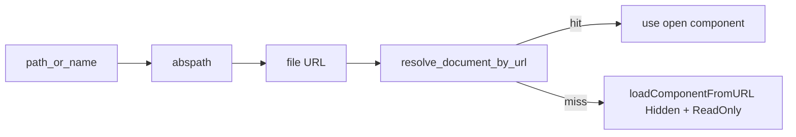
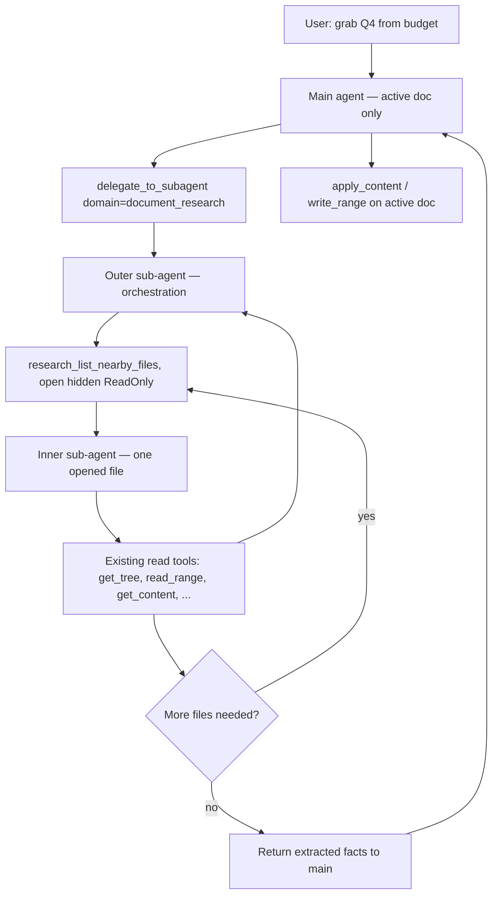
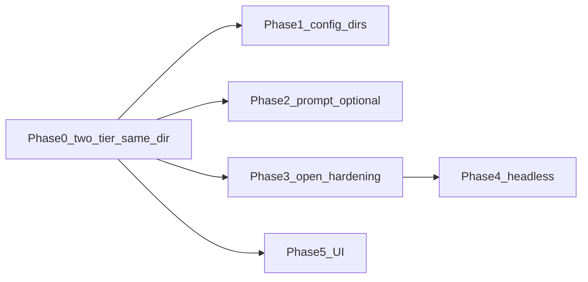

# Multi-Document Support — Development Plan

> **Terminology:** This doc previously used **workspace** as a placeholder for “the set of files the agent can see and read.” The final product term was decided as **document_research**. Code and config keys use the `document_research` domain.

> **Living document:** Update this file as phases ship, decisions get made, or scope changes. Link PRs and topic docs from [Related docs](#related-docs) and the [Changelog](#changelog).

---

## Problem

Today WriterAgent is effectively **single-document**: chat resolves one LO model from the sidebar frame, injects `[DOCUMENT CONTENT]` for that doc only, and tools operate on `ToolContext.doc`. Users want cross-document workflows without typing full paths:

- “Grab the Q4 numbers from our budget spreadsheet and add them to this table.” (Writer **or** Calc as the active doc)
- “Pull slide 3 talking points from the deck into this Writer doc.”

Unlike a code repo with thousands of files, a typical office folder has **tens** of documents; **fuzzy names** (“budget 2026”) should resolve without exact filenames. The `@` mention UI is nice-to-have; **backend listing + read** matters more.

---

## MVP (Phase 0) — **shipped**

**Status:** Phase 0 is implemented in-tree (2026-05-17). Automated tests: [`test_document_research.py`](../../tests/doc/test_document_research.py), [`test_document_research_specialized.py`](../../tests/doc/test_document_research_specialized.py), [`test_document_research_uno.py`](../../tests/doc/test_document_research_uno.py). Manual Calc acceptance (#1) still recommended before calling the feature “done” in production.

**Phase 0** provides same-directory discovery and cross-file **read** via **two-tier delegation**. Main adds only `document_research` to the existing delegate enum — no new core tools on main.

**User flow:** one `delegate_to_subagent(domain="document_research", task="…")` call → **outer** sub-agent lists/opens → **inner** sub-agent(s) read with production read tools → compact result to main → main writes **active** doc only.

- Same folder as the active saved document’s **parent directory** (no config dirs, no recursion).
- **Untitled** active doc: list from LibreOffice profile **Work** folder ([`get_work_directory`](../../plugin/doc/document_research.py) via `com.sun.star.util.thePathSettings`); if that path is missing, fall back to other **open** LO file URLs only (see [Edge cases](#edge-cases-and-failure-modes)).
- Later phases add config directories, prompt injection, UI, headless, and polish — see [Phased implementation](#phased-implementation).

---

## Design principles

| Principle | Detail |
| --------- | ------ |
| **Same read tools, not main’s schema** | The **inner** sub-agent calls the same production read tools as today (`get_content`, `get_tree`, `search`, `get_sheet_summary`, `read_range`, Draw read tools, …) via `SmolToolAdapter` — not a parallel extractor. Main chat does **not** register those tools; it only has **core** tools plus `delegate_to_subagent`. **Discovery** (`research_list_nearby_files` on the **outer** agent) and **targeting** (open hidden/read-only, point `ToolContext.doc` at that model) live in the document_research domain. |
| **Read-only on other files** | Mutation tools apply to the **active** document only. Sibling files are opened **read-only**; write APIs are **not** exposed on those models in Phase 0 (see [Read-only enforcement](#read-only-enforcement) and [Open questions](#open-questions) #4). |
| **Writer + Calc + Draw** | Calc is first-class (budget → table). Draw/Impress: `slide_list` + shape/text tools where applicable. |
| **Active doc unchanged** | Cross-doc reads must not steal focus or mutate the user’s window; hidden open in the **same** LO process for Phase 0. |
| **Fresh contexts when tool sets change** | **Main chat** keeps one OpenAI-style history; don’t swap its wire tool schema mid-thread. **Sub-agents** are ephemeral task runs: focused tool context, compact result, smol runtime torn down afterward. |
| **Two-tier delegation** | Outer picks the file; **inner** gets read tools for **that** `doc_type`. See [Two-tier sub-agent model](#two-tier-sub-agent-model). |
| **Headless later** | Target: headless / separate process for large files by default; **defer** until in-process hidden path is solid (Phase 4). |

---

## Data contracts

### `FileEntry`

Listing tools return a consistent shape (TypedDict or dataclass in `plugin/doc/document_research.py`):

| Field | Type | Notes |
| ----- | ---- | ----- |
| `path` | `str` | Absolute local path |
| `name` | `str` | Basename |
| `url` | `str` | `file:///…` for LO + MCP parity |
| `modified` | `float` | mtime; used for newest-first sort |
| `size_bytes` | `int` | Optional; used in Phase 3+ large-file heuristic |
| `doc_type_guess` | `"writer"` \| `"calc"` \| `"draw"` \| `"image"` \| `"unknown"` | From extension |
| `is_open` | `bool` | Desktop already has this URL |

**Exclude** the active document’s path from `research_list_nearby_files` results (do not offer “read self as sibling”).

### Extension allowlist

Constants in [`plugin/doc/document_research.py`](../../plugin/doc/document_research.py), referenced by tests. `research_list_nearby_files` takes optional **`file_kind`**: `"documents"` (default) or `"images"` (mutually exclusive listing modes).

**`file_kind=documents`** — `ALL_INDEXABLE_EXTENSIONS`: `.odt`, `.ott`, `.ods`, `.ots`, `.odp`, `.otp`, `.odg`, `.fodt`, `.fods`, `.fodp`

**`file_kind=images`** — `NEARBY_IMAGE_EXTENSIONS`: `.png`, `.jpg`, `.jpeg`, `.gif`, `.webp`, `.bmp`, `.svg` (discovery only; not readable via `research_delegate_read`)

**Exclude by convention:** LibreOffice lock/temp files (`~$*`), `*.tmp`, `*.bak`, and extensions outside the selected allowlist.

### `open_document_for_read(path | url) -> (model, doc_type)`

- [`resolve_document_by_url`](../../plugin/framework/uno_context.py) scans **already open** components only — it does **not** open closed files.
- New load props: **`Hidden=True`** and **`ReadOnly=True`**, loaded via `load_scratch_document` with target `_blank` on all platforms and registered as scratch. After loading, `attachResource("", ())` drops the copy's URL so File > Open and `document_open` load the file themselves instead of adopting the hidden read-only copy. UNO tests on Windows Hidden-open a `Budget_read.ods` copy, not the pooled Calc `storeAsURL` path (GHA 34639913692).
- If a sibling is already open **editable** in another window (never a research copy, whose URL was dropped), reuse that component via URL match; inner agent still gets a **read-only allowlist** (schema enforcement, not LO mode alone).

### Fuzzy name matching (Phase 0)

MVP: basename **substring** filter on `research_list_nearby_files(filter=…)` plus **newest-first** bias when multiple matches (e.g. `Budget_2026.ods` vs `Budget_2025.ods`). No Levenshtein required for Phase 0.

---

## Architecture

**Phase 0 path:** main agent → **outer** document_research sub-agent → **inner** read-only sub-agent(s) → back to main for writes on the active doc only.

**Document resolution today:** sidebar uses `frame.getController().getModel()` ([`SendButtonListener._get_document_model`](../../plugin/chatbot/panel.py)); MCP uses `X-Document-URL` + [`resolve_document_by_url`](../../plugin/framework/uno_context.py). Nearby reads add: filesystem path → file URL → match open component or `loadComponentFromURL`.

See [Threading / nested delegation](#threading--nested-delegation) for UNO thread rules.

---

## Tool API contract (in-process parity, read-only elsewhere)

**Main chat today:** sidebar exposes **core**-tier tools for the active doc plus one **`delegate_to_subagent`** gateway. That delegate’s `domain` parameter is an enum of specialized domains (shapes, python, web_research, …) — not the specialized tools themselves. [`ToolRegistry.get_schemas`](../../plugin/framework/tool.py) excludes `specialized` / `specialized_control` from the main wire list; specialized work runs in a sub-agent ([`DelegateToSubagent`](../../plugin/doc/specialized_base.py)).

**Multi-document extension:**

| Scope | APIs |
| ----- | ---- |
| **Active document** | Unchanged for **main** — same **core** read/write tools on `ToolContext.doc`, plus delegate gateway with **`document_research`** in the domain enum. |
| **Other files (document_research)** | **Same read tools** as in-process chat, invoked on a temporarily opened model (`Hidden` + `ReadOnly`). **Outer** exposes `research_list_nearby_files` and `research_delegate_read`. **No write tools** on sibling models unless we add a deliberate later feature. |

Implementation uses two nested smol runs (outer, then inner per file). Both call `ToolRegistry.execute` — no duplicate tool bodies.

Headless / out-of-process readers (Phase 4), when added, expose the **same logical read API** to the **inner** sub-agent; only the transport to LO changes.

**Phase 0 prompt:** `document_research` to research (my / our) personal documents; `web_research` to research public topics. `embedded` is active-doc OLE only. Main chat: one delegation with described **file(s)** and task (vague labels OK); outer agent matches via `research_list_nearby_files`.

---

## Two-tier sub-agent model

Cross-file reads use **two** ephemeral sub-agent runs (outer, then one or more inners). Sub-agents are **not** part of the user’s main chat history. The main agent keeps **the same wire tool list it has today** — **no new tools on main** beyond adding `workspace` to the delegate domain enum. Rationale: [Why two tiers](#why-two-tiers).

### Roles

| Layer | Responsibility | Tool surface |
| ----- | -------------- | ------------ |
| **Main agent** | User intent; edits **active** doc only. | **Core** tools on active `ToolContext.doc` + `delegate_to_subagent` (domain enum includes **`document_research`**). No specialized-tier tools on main’s wire schema. |
| **Outer sub-agent** | Natural-language **task** from main. Lists nearby files, resolves names, calls **inner** per file, aggregates. | `research_list_nearby_files`, `research_delegate_read(path, task)`, `workflow_finished` / final answer. **No** `apply_*` / `write_*`. |
| **Inner sub-agent** | One run per opened file; `doc_type` known. | **Read tools for that type only** — Writer inner never sees `read_range`; Calc inner never sees `get_tree`. Same production schemas; **no writes.** |

### Reference scenario

**User (on active report or sheet):** “Get Q4 numbers and put them in a table.”

| Step | Who | What happens |
| ---- | --- | ------------ |
| 1 | **Main** | Parses intent: read Q4 from a budget file; write table on **active** doc. Does **not** open siblings. |
| 2 | **Main** | `delegate_*(domain="document_research", task="Find Q4 numbers in the budget spreadsheet and return structured data")`. |
| 3 | **Outer** | `research_list_nearby_files(filter="budget")` → match candidates; newest-first bias. |
| 4 | **Outer** | `research_delegate_read(path, task)` — hidden read-only open → **inner** (e.g. “extract Q4 revenue”). |
| 5 | **Inner** | On Calc model: `get_sheet_summary` → `read_range`. On Writer budget: `search` / `get_content`. Returns to **outer**; inner discarded. |
| 6 | **Outer** | Repeat step 4 if needed; aggregate; **final_answer** to main. |
| 7 | **Main** | `write_range`, `apply_content`, etc. on **active** doc only. |

**Important:** Main issues **one** workspace delegation, then edits the active document with the returned payload.

### Shorter control-flow checklist

1. User: “Get Q4 numbers and put in a table.”
2. **Main** → delegate document_research with read task.
3. **Outer** → list → `research_delegate_read` → **inner** per file → aggregate → return to main.
4. **Main** → `write_*` / `apply_*` on **active** doc only.

### Why two tiers

**1. Within-session tool stability on main** — Sub-agents avoid mid-thread schema churn on main; results fold back as a single tool result.

**2. Right tools only after we know the file** — Inner allowlist depends on opened `doc_type` (`.ods` → Calc tools; `.odt` → Writer tools).

**3. Outer vs inner split** — Outer: discovery, open, multi-file loop, aggregate. Inner: one file, one modality.

**4. Multi-file orchestration** — Outer calls `research_delegate_read` separately per file before one return to main.

**5. Main stays lean** — Users who never use workspace pay **zero** extra tool-schema cost on main.

**6. Anti-pattern: read tools on main** — Pollutes the schema for everyone.

**Implementation note:** Same **gateway** pattern as `delegate_*(domain="shapes")`, but document_research adds a **nested** inner smol run via `research_delegate_read` (not a single-level domain like `python`’s tools). Infrastructure: [`DelegateToSubagent`](../../plugin/doc/specialized_base.py), [`build_toolcalling_agent`](../../plugin/chatbot/smol_agent.py) — see [../writer/specialized-toolsets.md](../writer/specialized-toolsets.md) and [smol-tool-architecture.md](smol-tool-architecture.md).

### Handoff mechanism (implemented)

- [`DelegateReadDocument`](../../plugin/doc/document_research_specialized.py): dedicated tool — **not** recursive `DelegateToSubagent.execute`. Resolves name off the main thread via [`resolve_path_or_name`](../../plugin/doc/document_research.py), opens via [`open_document_for_read`](../../plugin/doc/document_research.py) on the main thread (`main.run`).
- [`run_inner_read_agent`](../../plugin/doc/document_research_specialized.py): builds `ToolContext(doc=opened_model, read_only_target=True, …)`; runs smol with `READ_TOOLS_BY_DOC_TYPE[doc_type]` + `workflow_finished`.
- The tool returns `{status: "ok", path, doc_type, result}`; result is the finish tool's answer string. A plain-string final answer (no finish call: output-limit truncation or max steps) returns `status: "incomplete"`, code `SPECIALIZED_WORKFLOW_INCOMPLETE`, with the text on `message`. Inner error payloads pass through unchanged; a run with no answer returns the coded error `READ_EMPTY_RESULT`.
- Outer document_research sub-agent is still launched by [`DelegateToSubagent`](../../plugin/doc/specialized_base.py) with `active_domain="document_research"` (tools from [`document_research_tools.py`](../../plugin/doc/document_research_tools.py) + `DelegateReadDocument`).
- Inner ends with `workflow_finished` / `final_answer`; outer accumulates and returns one payload to main.

---

## Registration (doc module)

Document research is **cross-app**: active Writer may read a Calc `.ods` budget. Register on [`plugin/doc/`](../../plugin/doc/) with **`specialized_cross_cutting = True`** (same pattern as [`RunVenvPythonScript`](../../plugin/calc/python/venv.py)) so **Writer, Calc, and Draw** delegate gateways all expose `domain="document_research"`.

| Component | `tier` | `specialized_domain` | Notes |
| --------- | ------ | -------------------- | ----- |
| `research_list_nearby_files` | `specialized` | `document_research` | Outer agent only |
| `research_delegate_read` | `specialized` | `document_research` | Spawns inner smol; outer only |
| Inner read tools | — | — | **Not** a separate domain on main registry; allowlist inside `research_delegate_read` |

Gateway enum discovery: marker subclasses with `specialized_domain = "document_research"` on each app base — `ToolWriterDocumentResearchBase`, `ToolCalcDocumentResearchBase`, `ToolDrawDocumentResearchBase` in [`writer/specialized_base.py`](../../plugin/writer/specialized_base.py), [`calc/base.py`](../../plugin/calc/base.py), [`draw/base.py`](../../plugin/draw/base.py). Tools register once in [`plugin/doc/common_module.py`](../../plugin/doc/common_module.py) via `auto_discover(document_research_tools, document_research_specialized)`.

---

## Read-only enforcement

Schema omission alone is insufficient; Phase 0 enforces at execution time:

1. **`ToolContext.read_only_target`** — set on the inner agent’s context in [`run_inner_read_agent`](../../plugin/doc/document_research_specialized.py).
2. **Inner allowlist** — `READ_TOOLS_BY_DOC_TYPE` in [`document_research_specialized.py`](../../plugin/doc/document_research_specialized.py); inner uses `registry.get_tools(..., names=allowlist)` — not `active_domain="document_research"` on the opened model.
3. **Defense in depth** — [`ToolRegistry.execute`](../../plugin/framework/tool.py) returns `READ_ONLY_TARGET` when `ctx.read_only_target` and `tool.detects_mutation()`. The inner agent does not go through the registry: [`SmolToolAdapter.forward`](../../plugin/chatbot/smol_agent.py) applies the same check before `execute` / `execute_safe`.

---

## Threading / nested delegation

| Layer | Thread | UNO |
| ----- | ------ | --- |
| Main tool loop | Main | Sync tools via `execute_safe` |
| Outer smol | Worker ([`DelegateToSubagent.is_async`](../../plugin/doc/specialized_base.py)) | List/open via `main.call` / `main.run` or async open tool |
| Inner smol | Same worker as outer | Sync read tools via `SmolToolAdapter` (always marshals) → [`main.call`](../../plugin/chatbot/smol_agent.py) |

**Phase 0 tests (implemented):**

- [`test_document_research_specialized.py`](../../tests/doc/test_document_research_specialized.py): mock inner agent (no live LLM); `document_research` on all three delegates; `READ_ONLY_TARGET` guard; outer document_research tool surface; `research_delegate_read` is not a delegate gateway recurse.
- [`test_document_research_uno.py`](../../tests/doc/test_document_research_uno.py): hidden+read-only open; list excludes active file; inner path reads sibling via `read_range` on opened model.
- `stop_checker` is copied from parent to inner `ToolContext` in `run_inner_read_agent`.

See [../framework/streaming-and-threading.md](../framework/streaming-and-threading.md).

---

## Reusing existing read tools (not new extractors)

The **inner** sub-agent calls production read tools via `ToolRegistry.execute`:

1. **Outer** resolves path / name from catalog.
2. **Outer** obtains UNO `model` via `open_document_for_read` (see [Data contracts](#data-contracts)).
3. **Inner** receives `ToolContext(doc=model, doc_type=…, read_only_target=True, ctx=…)`.
4. **Inner** invokes read tools only:

| Source doc type | Typical inner allowlist |
| --------------- | ----------------------- |
| **Writer** | `get_content` ([`get_document_content.py`](../../plugin/writer/get_document_content.py); optional `include_images`, default false), `get_tree` ([`outline.py`](../../plugin/writer/outline.py)), `search` |
| **Calc** | `get_sheet_summary` ([`sheets.py`](../../plugin/calc/sheets.py)), `read_range` ([`cells.py`](../../plugin/calc/cells.py)) |
| **Draw / Impress** | `slide_list` ([`shapes.py`](../../plugin/draw/shapes.py)), `get_tree` ([`tree.py`](../../plugin/draw/tree.py)) — see `READ_TOOLS_BY_DOC_TYPE` in [`document_research_specialized.py`](../../plugin/doc/document_research_specialized.py) |

**Calc example:** User has `Q4_Report.odt` open → main delegates document_research → outer opens `Budget_2026.ods` → inner `get_sheet_summary` + `read_range` → main `apply_content` on active doc.

**Large Writer docs:** Inner should prefer `get_tree` / `search` before full `get_content` (existing truncation limits apply).

---

## Edge cases and failure modes

| Case | Behavior |
| ---- | -------- |
| **Untitled / unsaved active doc** | **Implemented:** [`resolve_listing_directory`](../../plugin/doc/document_research.py) uses LO profile **Work** path (`thePathSettings` → `Work`); if no directory, list other **open** LO documents only; if none, tool error with a clear message. |
| **Active file in directory listing** | Exclude self from `research_list_nearby_files`. |
| **Permission denied / I/O error** | Tool error with `details.path`. |
| **File modified on disk after open** | Phase 0: no cache; re-open on next delegate if needed. Phase 6 may add mtime-keyed metadata. |
| **Same path already open** | Reuse via `resolve_document_by_url`. |
| **Non-file URL** (`google-docs:`, etc.) | `get_document_path` → `None`; treat like untitled. |
| **Huge directory** | Cap list (e.g. 100 entries); set `truncated: true` in tool result. |
| **Sensitive neighbors** | Phase 1+ optional exclude globs (`.*`, `*.pem`, …) in config. |

---

## Scope boundaries

| Surface | Note |
| ------- | ---- |
| **Sidebar chat** | Primary target for workspace delegation. |
| **Menu “Chat with Document”** | No tool-calling today ([AGENTS.md](../../AGENTS.md)) — workspace **not** supported until menu gains tools. |
| **Librarian mode** | No document_research reads until document mode (`switch_mode` / `switch_to_document_mode`). |
| **Extend / Edit selection** | Single-doc selection path; out of scope unless explicitly wired. |
| **Hermes ACP** | Defer; same registry tools if host exposes delegate gateway later. |

---

## Open questions

Record decisions here as we learn.

| # | Question | Notes |
| - | -------- | ----- |
| 1 | **Catalog in main system prompt?** | Option A: inject `[NEARBY FILES]` every turn. Option B: outer calls `list_*` when needed (**default for Phase 0**). Option C: hybrid when ≤N files or user mentions another doc. Revisit in Phase 2. |
| 2 | **Main vs sub-agent for multi-file tasks** | **Decision: two-tier delegation in Phase 0** — main only `delegate_*(domain="document_research", …)`; outer orchestrates; inner reads per file. Same **gateway** as `domain="shapes"`; unique **nested** inner smol via `research_delegate_read`. |
| 3 | **Untitled / unsaved active doc** | **Decision (Phase 0):** saved parent dir → else **Work** path → else open-docs-only list. Unit-tested (`test_get_work_directory`, `test_resolve_listing_directory_work_fallback`). |
| 4 | **Write-back to nearby files** | **Out of scope:** siblings read-only; writes on active doc only. |
| 5 | **Final naming** | **Decision:** named `document_research` to best describe document-centric cross-file reading. |
| 6 | **Inner allowlist** | **Decision (Phase 0):** static `READ_TOOLS_BY_DOC_TYPE` in [`document_research_specialized.py`](../../plugin/doc/document_research_specialized.py). |
| 7 | **Max files per list** | Cap (e.g. 100) — document in `research_list_nearby_files` result. |

---

## Phased implementation

Phases are incremental; each shippable with `make test`. Phase dependency:

### Phase 0 — Same-directory MVP (two-tier delegation) — **shipped**

**Goal:** End-to-end cross-file read from the active document’s parent directory (or Work / open-docs fallbacks).

**Main (unchanged wire shape):**

- `delegate_to_subagent(domain="document_research", task="…")` only.
- No `research_list_nearby_files`, no read tools, no new core tools on main.
- Delegate gateway descriptions mention `domain=document_research` (Writer/Calc/Draw).

**Outer sub-agent (`specialized_domain="document_research"`):**

- [`ListNearbyFiles`](../../plugin/doc/document_research_tools.py) → [`research_list_nearby_files`](../../plugin/doc/document_research.py): `ALL_INDEXABLE_EXTENSIONS`, newest first, exclude active path, optional `filter`, `truncated` when capped (default 100). When a cap fires, the tool result also carries a one-sentence top-level `hint` (next call or argument). When a named object is missing, errors carry `details.similar` (up to five close names) and `details.hint` (which list tool to call).
- [`DelegateReadDocument`](../../plugin/doc/document_research_specialized.py): `path_or_name` + `task`; hidden+read-only open (or reuse open); spawns inner; returns `{ path, doc_type, result }`.
- `workflow_finished` / final answer to main (same as other specialized domains).

**Inner sub-agent (per opened file):**

- `READ_TOOLS_BY_DOC_TYPE` allowlist; [`run_inner_read_agent`](../../plugin/doc/document_research_specialized.py).
- `ToolContext.doc` = opened model; `read_only_target=True` — see [read-only enforcement](#read-only-enforcement).
- One inner run per `research_delegate_read` call; discarded after return.

**Library ([`plugin/doc/document_research.py`](../../plugin/doc/document_research.py)):**

- `FileEntry`, `ALL_INDEXABLE_EXTENSIONS`, `get_document_directory`, `get_work_directory`, `resolve_listing_directory`, `research_list_nearby_files`, `resolve_path_or_name`, `open_document_for_read`, `guess_doc_type_from_path`.

**Module wiring:** [`plugin/doc/common_module.py`](../../plugin/doc/common_module.py) `auto_discover` for `document_research_tools` and `document_research_specialized`. No new keys in [`module.yaml`](../../plugin/doc/module.yaml).

**Out of scope Phase 0:** config directories, `[NEARBY FILES]` prompt injection, `@` UI, headless, metadata cache, write-back to siblings.

**Done when:**

- [ ] Calc acceptance scenario #1 (Q4 budget) passes manually (recommended before release notes).
- [x] `make test` / pytest green: [`test_document_research.py`](../../tests/doc/test_document_research.py), [`test_document_research_specialized.py`](../../tests/doc/test_document_research_specialized.py).
- [x] UNO: hidden open, list excludes self, sibling read via `read_range` — [`test_document_research_uno.py`](../../tests/doc/test_document_research_uno.py).
- [ ] Active window focus unchanged after cross-file read (manual check).

---

### Phase 1 — Config-expanded directories — **deferred (low priority)**

> **Status (2026-05-17):** Deferred. Phase 0 (same-folder / two-tier workspace) is sufficient for now. Revisit when users need folders outside the active document’s parent (e.g. shared project drive). A draft implementation plan exists in `.cursor/plans/` but is not scheduled.

**Goal:** User-configured extra roots beyond same-folder listing.

- Config key: `workspace_extra_directories` (JSON array of absolute paths) — name TBD per open question #5.
- `research_list_nearby_files` merges: active doc’s parent dir + configured dirs, deduped, newest-first.
- Settings UI: text field in [`dialog_views.py`](../../plugin/chatbot/dialog_views.py) / manifest registry (see [`config.py`](../../plugin/framework/config.py)).
- **Tests:** merge, dedupe, invalid path handling.

**Done when:**

- [ ] Config round-trip and listing merge covered by unit tests.
- [ ] Optional exclude globs for sensitive filenames (see edge cases).

---

### Phase 2 — Prompt integration (optional / gated)

**Goal:** Model may see filenames without calling `list_*` first.

- Compact `[NEARBY FILES]` in [`panel.py`](../../plugin/chatbot/panel.py) or via [`get_document_context_for_chat`](../../plugin/doc/document_helpers.py) — cap separately from 8k doc context (e.g. 50 files / 2000 chars); consider `chat_context_length` config.
- Guidance in [`constants.py`](../../plugin/framework/constants.py) templates, gated by config flag default **off**.
- Re-evaluate open question #1 after measuring token use.

**Done when:**

- [ ] Prompt snapshot tests; flag off by default.

---

### Phase 3 — Hidden open hardening

**Goal:** Reliable in-process opens without disturbing the user.

- Weakref cache of hidden models per path; close after read or idle timeout.
- Size heuristic: small files in-process; threshold for “large” (log/warn only until Phase 4).
- UNO tests: Writer, Calc, Draw/Impress samples.
- Verify **`ToolContext.doc`** scoping between active and opened models (not `DocumentCache` — inactive in codebase).

**Done when:**

- [ ] UNO tests for cache lifecycle and multi-doc isolation.

---

### Phase 4 — Headless / separate process (deferred)

**Goal:** Large files do not block the UI LO instance.

- Persistent or one-shot `soffice --headless` with separate user profile (`--env:UserInstallation=...`).
- Worker script or UNO bridge; [`AsyncProcess`](../../plugin/framework/worker_pool.py) for lifecycle.
- Default to headless for non-small docs once stable; fallback to in-process hidden open on failure.
- Inner sub-agent API unchanged; transport only.

**Done when:**

- [ ] Large-file scenario does not block main LO UI thread.

---

### Phase 5 — UI: `@` mentions and pickers (deferred)

**Goal:** Discoverability; not required for core behavior.

- [`QueryKeyListener`](../../plugin/chatbot/panel.py): `@` triggers filtered list; button + `FilePicker` acceptable MVP.
- Insert token or pass selected path into send pipeline.
- See [sidebar-implementation.md](sidebar-implementation.md).

**Done when:**

- [ ] Manual UI checklist completed.

#### Status surfacing in chat

**Shipped (open-only):** When the outer `document_research` sub-agent calls `research_delegate_read`, the sidebar chat shows a short status block (`Tool: research_delegate_read` + open preview line — same shape as web research’s `Tool: web_search` + query preview). Formatting lives in [`web_research_chat.py`](../../plugin/chatbot/web_research_chat.py); the outer delegate’s `tool_call_handler` in [`specialized_base.py`](../../plugin/doc/specialized_base.py) appends via `chat_append_callback` (wired from [`tool_loop.py`](../../plugin/chatbot/tool_loop.py) for `domain=document_research`). Status only — no HITL approval.

**Deferred (not implemented):**

- `research_list_nearby_files` preview blocks when the outer agent lists siblings.
- Inner read-tool steps (`read_range`, `get_content`, …) via `chat_append_callback` on the inner `ToolContext` in [`document_research_specialized.py`](../../plugin/doc/document_research_specialized.py) — useful when step-by-step cross-doc read visibility is desired (similar to “Show search thinking” for web research).
- Optional config gate (e.g. `chatbot.show_document_research_steps` or tie to an existing thinking toggle) if chat noise becomes an issue.
- MCP parity: [`mcp_protocol.py`](../../plugin/mcp_server/mcp_protocol.py) `ToolContext` has no chat sink today; hosts would need a stream hook if they want the same status lines.

---

### Phase 6 — Polish

**Goal:** Performance, MCP clarity, optional integrations.

- Metadata cache (title, headings, sheet names) keyed by path + mtime — SQLite optional.
- **MCP** (see below).
- Recent LO documents list — if worth the coupling.
- Drag-and-drop onto chat.

**Done when:**

- [ ] MCP cross-doc path documented and tested.

#### MCP (Phase 6)

- **Active document:** unchanged — `X-Document-URL` on [`mcp_protocol.py`](../../plugin/mcp_server/mcp_protocol.py).
- **Nearby reads:** path or `url` in tool args / delegate task; **do not** retarget `X-Document-URL` to sibling files.
- **Tool surface:** same as sidebar — document_research via `delegate_to_subagent(domain="document_research", …)`, not dozens of new MCP tool names ([../mcp-protocol.md](../mcp-protocol.md) specialized-tier policy).
- **Test:** [`test_mcp_server.py`](../../plugin/tests/mcp_server/test_mcp_server.py) — document_research delegate with header pointing at active Writer doc.

---

### Phase 7 — Advanced Workflows (Future)

**Goal:** Move beyond simple reading to powerful cross-document aggregation and provenance.

#### 7.1 Cross-Document Search ("Office Grep") — **shipped**

*   **Concept:** A dedicated tool for the outer `document_research` sub-agent to find keywords across multiple files without manually delegating to each one sequentially.
*   **Implementation:** [`research_grep_nearby_files`](plugin/doc/document_research_tools.py) in [`plugin/doc/document_research_grep.py`](../../plugin/doc/document_research_grep.py). Args: `pattern`, optional `file_subset` (basename token such as `budget` → `*budget*.od*` via `scan_nearby_files`, an absolute path, or a `file://` URL of one existing file; a `file://` URL is not a listing filter), caps (`max_files`, `max_results_per_file`, `max_total_results`). Opens each candidate hidden+read-only, searches by type (Writer paragraphs and table cells read visible text via `get_string_without_tracked_deletions` so tracked deletions do not match, with **automatic 2-paragraph context**; Calc `findAll` all sheets; Draw shape text with shape cap). Draw `match_count` is the number of matches returned: each page is searched with the remaining result budget. Draw `partial` is true when one more matching shape exists beyond that slice (the walk looks at one extra hit, same idea as Calc), or when the shape cap is hit with result budget left, or when Stop cuts the scan. Writer `match_count` is the number of matches returned; `partial` is true when the document has more hits than that slice, or when Stop cut Writer extraction or the paragraph scan. Calc `partial` is true when the sheet has more hits than the returned slice; `match_count` is the returned length, same as Writer and Draw. Stop is checked before each file and again after that file's search returns; either check, including on the last file, returns `USER_STOPPED` and does not include hits. Stop during the listing (the main-thread read of open documents and folder, or the folder scan) also returns `USER_STOPPED`. Stop is also checked on each Writer paragraph during text extraction and inside `search_paragraph_texts`. `get_paragraph_ranges` still runs to completion. An invalid regex returns one `Invalid regex:` error before any file is listed or opened. Returns snippet previews and closes hidden opens; grep does not call `processEventsToIdle` between files because the worker must not call that helper, and the chat drain pumps. One main-thread hop opens, searches, and closes each file; a marshal TimeoutError/RuntimeError for one file is recorded in errors and the scan continues. Snippet text and Writer context paragraphs are capped at 200 characters with a trailing "…" (same budget as Search hit text). Prefer grep before `research_delegate_read` when locating which file contains a keyword (hint in [`specialized_base.py`](../../plugin/doc/specialized_base.py)). `research_list_nearby_files`, grep and `research_search_nearby_files` read that state through `resolve_listing_state`.
*   **Tests:** [`tests/doc/test_document_research_grep.py`](../../tests/doc/test_document_research_grep.py), [`tests/doc/test_document_research_grep_uno.py`](../../tests/doc/test_document_research_grep_uno.py).

#### 7.2 Metadata Caching ("Librarian's Index")
*   **Concept:** "Remember" the structure of nearby files so the agent can answer "Which document has the Q3 numbers?" instantly.
*   **Implementation:** Expand the Phase 6 polish concept. Create `plugin/doc/nearby_cache.py` (using SQLite or JSON). When `open_document_for_read` is used, extract and cache the `get_tree` (Writer) or `get_sheet_summary` (Calc) keyed by `(path, st_mtime)`. Modify `research_list_nearby_files` to optionally return this cached structural summary in the `FileEntry` so the outer agent sees what's inside files without opening them.

#### 7.3 Automatic Citations & Provenance
*   **Concept:** When facts are pulled from sibling files, automatically cite the source.
*   **Implementation:** This is primarily a prompt engineering and main-agent workflow update.
    *   Update `DELEGATION_USER_FILE_DATA_HINT` in [`plugin/framework/constants.py`](../../plugin/framework/constants.py) to instruct the main agent: *"When inserting information extracted from nearby files, use footnotes or explicit text references (e.g., 'Source: Budget_2026.ods') to cite the origin."*
    *   Ensure the inner agent always returns the `path` and `name` alongside the extracted facts (currently `DelegateReadDocument` returns `{ status, path, doc_type, result }`).

#### 7.4 Multi-File Comparison (Native LO Compare)
*   **Concept:** Compare versions of documents (e.g., "What changed between v1 and v2?") using LibreOffice's built-in comparison engine.
*   **Implementation:** 
    *   Create a specialized tool `CompareDocuments(path_a, path_b)` in [`plugin/doc/document_research_tools.py`](../../plugin/doc/document_research_tools.py).
    *   **Logic:**
        1. Open `path_b` (the "newer" version) hidden.
        2. Use `XDispatchHelper` to execute `.uno:CompareDocuments` on the frame of `path_b`, passing the URL of `path_a` as the "original" document.
        3. LibreOffice automatically generates **Tracked Changes (Redlines)** in `path_b`.
        4. The sub-agent then uses the existing `get_redline_summary` (Writer) or `get_change_track` (Calc) tools to extract a high-level summary of exactly what was added, deleted, or changed.
    *   **Benefit:** Provides a far more accurate and "office-native" understanding of changes than a raw text diff, including formatting and structural changes. This saves the LLM from having to hold two massive documents in its context window simultaneously.

---

## Calc-specific scenarios (acceptance checks)

Use these to validate design and tests (Phase 0 targets #1–#5):

1. **Active Calc, read sibling Calc:** main delegates → outer lists/opens budget → inner `read_range` → outer returns figures → main `write_range` on active sheet.
2. **Active Calc, read sibling Writer:** inner `get_content` on brief → main `insert_html` / `write_range`.
3. **Active Writer, read sibling Calc:** inner `get_sheet_summary` + `read_range` → main `apply_content`.
4. **Multiple budgets:** outer `research_list_nearby_files(filter="budget")`, disambiguate, optionally run inner twice before returning to main.
5. **Formula semantics:** main respects Calc `;` separator rules ([`CALC_FORMULA_SYNTAX`](../../plugin/framework/constants.py)) when writing active sheet only.

---

## Writer / Draw scenarios (acceptance checks)

1. **Outline-first:** `get_tree` on nearby `.odt` before full read for long docs.
2. **Search:** `search` on nearby file for “Q4” instead of full HTML dump.
3. **Draw/Impress:** Nearby `.odp` → `slide_list` + text extraction; insert into active Writer/Calc via main write tools.

---

## Files and entry points

### Phase 0 (shipped)

| Area | Path |
| ---- | ---- |
| Catalog + hidden open | [`plugin/doc/document_research.py`](../../plugin/doc/document_research.py) |
| Outer tools | [`plugin/doc/document_research_tools.py`](../../plugin/doc/document_research_tools.py) — `research_list_nearby_files`, `research_grep_nearby_files` |
| Grep library | [`plugin/doc/document_research_grep.py`](../../plugin/doc/document_research_grep.py) |
| Inner + `research_delegate_read` | [`plugin/doc/document_research_specialized.py`](../../plugin/doc/document_research_specialized.py) |
| Module `auto_discover` | [`plugin/doc/common_module.py`](../../plugin/doc/common_module.py) |
| Domain enum markers | [`plugin/writer/specialized_base.py`](../../plugin/writer/specialized_base.py) (`ToolWriterDocumentResearchBase`), [`plugin/calc/base.py`](../../plugin/calc/base.py), [`plugin/draw/base.py`](../../plugin/draw/base.py) |
| Delegate gateway + document_research guard | [`plugin/doc/specialized_base.py`](../../plugin/doc/specialized_base.py) |
| `read_only_target` + registry guard | [`plugin/framework/tool.py`](../../plugin/framework/tool.py) |
| Unit tests | [`tests/doc/test_document_research.py`](../../tests/doc/test_document_research.py), [`test_document_research_specialized.py`](../../tests/doc/test_document_research_specialized.py), [`test_document_research_grep.py`](../../tests/doc/test_document_research_grep.py) |
| UNO tests | [`tests/doc/test_document_research_uno.py`](../../tests/doc/test_document_research_uno.py), [`test_document_research_grep_uno.py`](../../tests/doc/test_document_research_grep_uno.py) |

### Later phases

| Area | Path |
| ---- | ---- |
| Config keys (Phase 1+) | [`plugin/framework/config.py`](../../plugin/framework/config.py), [`manifest_registry.py`](../../scripts/manifest_registry.py) |
| Document path / URL | [`plugin/framework/uno_context.py`](../../plugin/framework/uno_context.py) |
| Chat context / prompts (Phase 2) | [`plugin/chatbot/panel.py`](../../plugin/chatbot/panel.py), [`plugin/framework/constants.py`](../../plugin/framework/constants.py) |
| Tool loop | [`plugin/chatbot/tool_loop.py`](../../plugin/chatbot/tool_loop.py) |
| MCP (Phase 6) | [`plugin/mcp_server/mcp_protocol.py`](../../plugin/mcp_server/mcp_protocol.py) |

---

## Test strategy

| Phase | Unit | UNO / integration |
| ----- | ---- | ----------------- |
| **0** | [`test_document_research.py`](../../tests/doc/test_document_research.py): scandir, extensions, sort, exclude self, filter, truncate, Work-path fallback | [`test_document_research_uno.py`](../../tests/doc/test_document_research_uno.py): hidden+read-only open; list; sibling `read_range` |
| **0** | [`test_document_research_specialized.py`](../../tests/doc/test_document_research_specialized.py): `document_research` on all delegates; mock inner; read-only guard; no gateway recurse | — |
| **1** | Config merge, dedupe | — |
| **2** | Prompt snapshot / max length | — |
| **3** | — | Cache, close-on-idle, Writer/Calc/Draw samples; `ToolContext.doc` isolation |
| **4** | — | Optional subprocess mocks |
| **5** | — | Manual UI checklist |
| **6** | Metadata cache | MCP document_research delegate test |

Per [AGENTS.md](../../AGENTS.md): matching `test_*.py` names; run `make test` before calling a phase done.

---

## Related docs

- [sidebar-implementation.md](sidebar-implementation.md) — frame-bound doc, send pipeline
- [smol-tool-architecture.md](smol-tool-architecture.md) — sub-agents, tool loop
- [../writer/specialized-toolsets.md](../writer/specialized-toolsets.md) — nested delegation, gateway pattern
- [../framework/streaming-and-threading.md](../framework/streaming-and-threading.md) — main-thread UNO, queue drain
- [../calc/specialized-toolsets.md](../calc/specialized-toolsets.md) — Calc tool surface
- [peer-messaging.md](peer-messaging.md) — Writer ↔ Calc ↔ Draw async `peer_send_work` / `peer_send_result` (A1 user-send + `ctx.doc` envelope; research stays read-only)
- [../mcp-protocol.md](../mcp-protocol.md) — `X-Document-URL`, MCP tool policy
- [../chat/search.md](../chat/search.md) — external fetch (contrast with nearby files)

---

## Changelog

| Date | Phase / change | PR / notes |
| ---- | -------------- | ---------- |
| 2026-09-08 | Peer-send A1 shipped: Writer ↔ Calc ↔ Draw via async `peer_send_work` / `peer_send_result`; research stays read-only — [peer-messaging.md](peer-messaging.md) | — |
| 2026-05-20 | **Phase 7.1 shipped:** `research_grep_nearby_files` + `document_research_grep.py`; shared Writer/Calc search helpers; CPU caps + `processEventsToIdle` between files | — |
| 2026-05-19 | **Chat status (open-only):** tool + preview blocks for `research_delegate_read` via `chat_append_callback` — [`web_research_chat.py`](../../plugin/chatbot/web_research_chat.py), [`specialized_base.py`](../../plugin/doc/specialized_base.py), [`tool_loop.py`](../../plugin/chatbot/tool_loop.py) | — |
| 2026-05-17 | **Phase 0 shipped:** `nearby.py`, `nearby_tools.py`, `nearby_specialized.py`; `document_research` on Writer/Calc/Draw delegates; two-tier smol (outer list/delegate_read, inner `READ_TOOLS_BY_DOC_TYPE`); `ToolContext.read_only_target` + `READ_ONLY_TARGET`; untitled → Work path then open-docs fallback; tests in `tests/doc/test_nearby*.py` | — |
| *(prior)* | Plan refresh: Phase 0 = full two-tier delegation; phases renumbered 0–6; data contracts, threading, edge cases | — |

---

## Open

- `[feature M post-v1 few]` Config-expanded directories (`workspace_extra_directories`) so document_research can list folders beyond the active document's parent, plus optional exclude globs for sensitive filenames. (§ Phase 1 Config-expanded directories)
- `[idea M few]` Gated `[NEARBY FILES]` catalog in the chat prompt so the model sees filenames without calling the list tool first. (§ Phase 2 Prompt integration)
- `[eng M many]` Harden hidden opens with a weakref cache of opened models, idle close, a large-file size heuristic, and UNO tests for multi-doc isolation. (§ Phase 3 Hidden open hardening)
- `[eng L many]` Headless or separate-process reader so large sibling files do not block the UI LibreOffice instance. (§ Phase 4 Headless / separate process)
- `[feature M many]` `@` mentions and a file picker in the sidebar to name another document. (§ Phase 5 UI: `@` mentions and pickers)
- `[feature S few]` Show chat status blocks for `research_list_nearby_files` and for inner read-tool steps, optionally behind a config toggle, with MCP parity needing a chat sink. (§ Status surfacing in chat)
- `[feature S few]` Document and test the MCP cross-document path for document_research. (§ Phase 6 Polish)
- `[feature M many]` Drag-and-drop onto chat and a recent-documents list as document_research inputs. (§ Phase 6 Polish)
- `[feature M many]` Metadata cache of nearby-file structure keyed by path and mtime so the agent can answer which document has given numbers. (§ 7.2 Metadata Caching)
- `[feature S many]` Automatic citations: instruct the main agent to cite the source file when inserting facts from sibling documents. (§ 7.3 Automatic Citations & Provenance)
- `[feature M many]` `CompareDocuments` tool using LibreOffice's native compare to produce tracked changes between two file versions. (§ 7.4 Multi-File Comparison)
