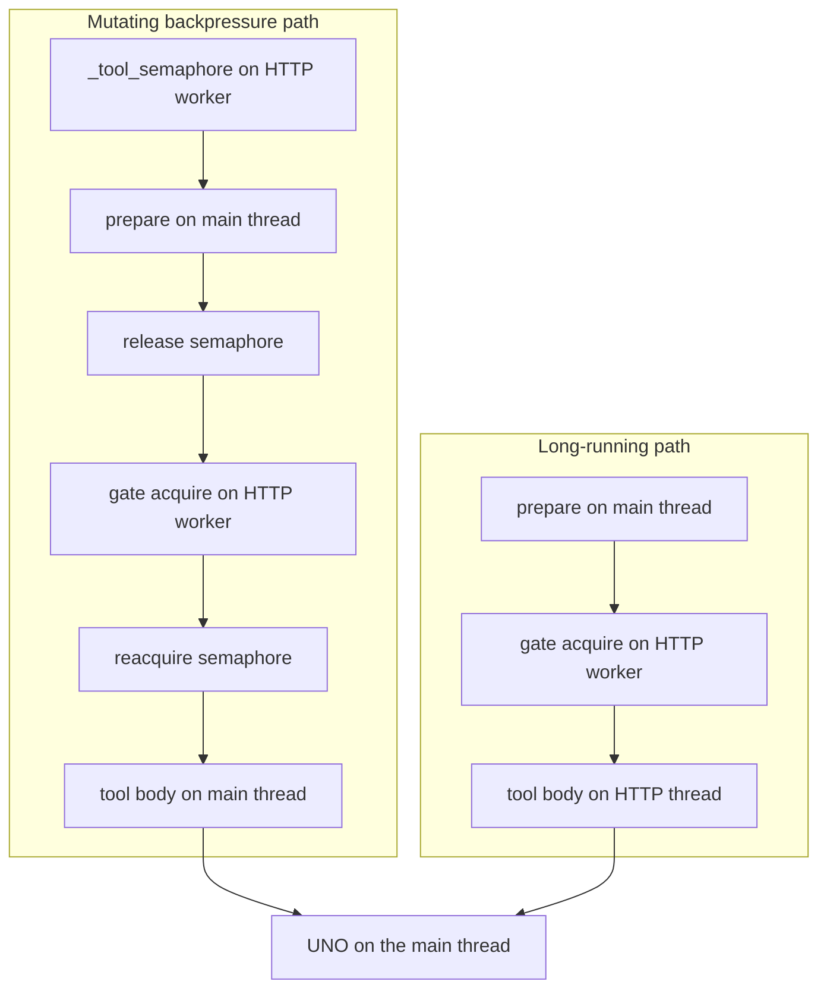
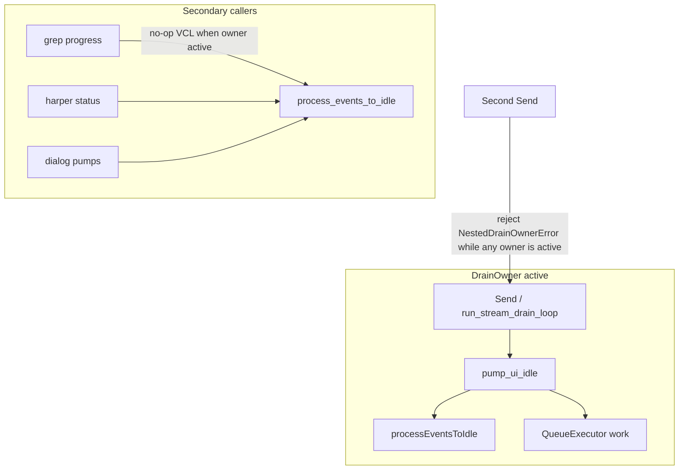
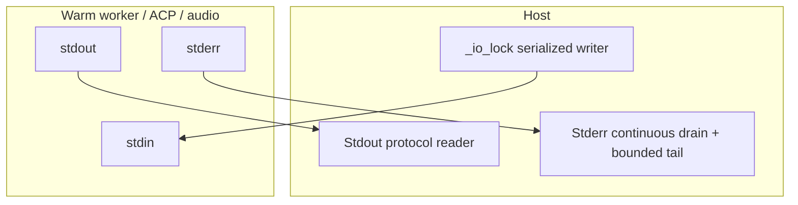

# WriterAgent Threading Architecture

This document outlines the threading and concurrency model used within the WriterAgent project (located in the `plugin/` directory). It details how backgrounds tasks, asynchronous network communication, streaming LLM execution, and external process management are handled without blocking the LibreOffice/UNO main UI thread.

## Overview

The LibreOffice UNO environment is **not thread-safe**. Calling UNO API methods from background threads can lead to unexpected UI behavior, corruption, or outright crashes, particularly with complex documents or frequent UI updates. 

Because WriterAgent connects to external LLM services and relies on streaming responses, it cannot block the main UI thread during these network calls or when waiting for AI generation. Therefore, WriterAgent relies heavily on standard Python threading for asynchronous I/O and process monitoring, coupled with specific mechanisms to marshal results back to the UNO main thread when document manipulation or UI updates are required.

## Threading Components

### 1. Main Thread Dispatch (`plugin/framework/queue_executor.py`)

This is the core concurrency bridge. Because background threads (like the HTTP server or AI streaming loop) cannot safely execute UNO commands, they use `execute_on_main_thread(fn, *args, **kwargs)` to offload UNO interactions back to the main thread.

*   **Mechanism:** It pushes a `_WorkItem` containing the callable and arguments onto a `queue.Queue`. It then signals LibreOffice to wake up and process the queue using `com.sun.star.awt.AsyncCallback`. ``post()`` before that callback exists keeps a short pending list. A shorter list stores the callable. A full list waits for a flush, then raises `TimeoutError` without storing that callable. When initialization has finished and AsyncCallback is `None` (eval harness), a full list raises `TimeoutError` immediately and does not store it. If a flush fails partway through, the not-yet-enqueued posts go back on that list, the error is logged, and the caller's own `execute`, `post`, or `set_context` still proceeds. The grammar in-flight gate wakes one waiter per release (`notify`), because one slot opened.
*   **Synchronization:** The calling background thread blocks on a `threading.Event()` (`_WorkItem.event.wait()`) until the main thread picks up the item, executes it, and sets the result or exception. This provides a synchronous feel to the caller while executing safely on the UI thread.
*   **Safety:** A `threading.Lock` (`_init_lock`) protects the lazy initialization of the AsyncCallback UNO service.

### 2. HTTP Server and MCP Protocol (`plugin/mcp/`)

The plugin runs an embedded HTTP server to provide a local API and support the Model Context Protocol (MCP).

*   **`server.py`:** The `HttpServer` wrapper (inner `_ThreadedHTTPServer`, subclassing the shared `DualStackThreadPoolHTTPServer` from `plugin.framework.http_server`) runs in a dedicated daemon thread (`name="http-server"`) via `run_in_background(..., dedicated=True)`. This allows the server to perpetually listen for incoming requests on IPv4 and IPv6 loopback without occupying the bounded background pool. Accepted connections run on `_RequestThreads`, a bounded daemon pool in that module. It is not `ThreadPoolExecutor`: the stdlib pool's atexit hook joins its workers, so a handler blocked in SSE `select` or on the UI queue would hold LibreOffice open. Each submit starts a thread while unfinished calls exceed the live thread count, up to the cap; a handler blocked on a permit is unfinished work, so a later accept (including `GET /health`) is not left queued while a spare slot exists. Past the ceiling the accept thread closes the socket and writes no response. Compute HTTP 503 is worker admission, not this path. `SO_REUSEADDR` follows `allow_reuse_address` (off on Windows). An empty bind host is loopback, not every interface. Stopping the server signals a non-blocking wake socketpair to exit the accept loop immediately instead of waiting for poll interval. Worker exceptions are logged; TLS handshake errors are logged as disconnects.
*   **Route table:** `HttpRouteRegistry` (`plugin/mcp/routes.py`) guards its dict with a lock. Workers read routes while MCP toggle adds or removes them. `list_routes` copies the keys under that lock, so `GET /` cannot raise `RuntimeError: dictionary changed size during iteration`. Register and unregister hold the lock across the whole batch, so a request sees the previous set or the new set.
*   **`mcp_protocol.py`:** Incoming HTTP requests land on the server's thread. Document resolution and UNO context lookup run on the main thread via `QueueExecutor`; tool bodies that touch the document either run entirely on the main thread (backpressure path) or on the HTTP worker with UNO work marshalled through `execute_on_main_thread` (long-running path).

#### MCP tool execution paths

MCP `tools/call` routes to one of two handlers in [`mcp_protocol.py`](../../plugin/mcp/mcp_protocol.py), when `is_async()` returns exactly `True`. `long_running = True` alone stays on `_execute_with_backpressure`:

| Path | Method | Tool body | Global limit | Per-document gate |
|------|--------|-----------|--------------|-------------------|
| Backpressure | `_execute_with_backpressure` | Main (via queue) | `_tool_semaphore(1)` → `BusyError` if busy | Mutating tools only; acquired on the HTTP worker after the semaphore is released |
| Long-running | `_execute_long_running` | HTTP worker (UNO marshalled) | None (by design) | Mutating tools only; acquired on the HTTP worker |



**Why two layers?** The global semaphore keeps fast MCP tools from piling up on the main thread and surfaces `BusyError` (HTTP 429) under overload. Tools whose `is_async()` is exactly `True` (image generation, delegate sub-agents) skip the semaphore so a minutes-long job does not block every other MCP client. That left a hole: parallel long-running mutators could target the same document. The per-document gate closes that without blocking read-only work or work on other documents.

A mutating backpressure call holds `_tool_semaphore` for prepare, releases it before `_document_mutation_gate`, and acquires it again only for the tool body. Waiting on a document another mutator already holds does not 429 fast calls for other documents. Read-only backpressure never takes the gate, so it keeps the semaphore from prepare through the body. Long-running tools still take only the gate.

**Per-document gate:** [`_document_mutation_gate`](../../plugin/mcp/mcp_protocol.py) serializes mutating MCP runs that share a normalized document key (`X-Document-URL`, `doc.getURL()`, or `RuntimeUID`). Tools opt out via [`ToolBase.requires_document_lock()`](../../plugin/framework/tool.py) (defaults to `detects_mutation()`). Delegate gateways return `False` for read-only domains (`document_research`, `web_research`, `vision`). Both paths acquire the gate on the HTTP worker. The backpressure path used to acquire it inside the main-thread dispatch, so a long-running mutator holding the gate froze the UI for up to the 30s timeout and stalled that mutator's own UNO marshal.

**UNO thread safety:** All UNO access is marshalled to the LibreOffice main thread. The per-document gate is **logical** serialization — it prevents overlapping mutating MCP tool runs on the same file, not raw cross-thread UNO calls. `bypass_thread_guard` is an eval-harness switch on `ToolRegistry.execute`. MCP and the sidebar tool loop pass `False`. A JSON object spread into `execute` cannot set it: `True` counts only when the caller writes that keyword in the call.

**Tests:** [`tests/mcp/test_long_running_concurrency.py`](../../tests/mcp/test_long_running_concurrency.py) covers same/different document, read-only, delegate opt-out, normalized URLs, cross-path (long-running + backpressure), unknown-tool conservative locking, backpressure waiting for the gate off the main thread, and gate wait does not hold the global semaphore. [`tests/mcp/test_mcp_protocol.py`](../../tests/mcp/test_mcp_protocol.py) covers a client `bypass_thread_guard` argument. [`tests/chatbot/test_tool_loop_actions.py`](../../tests/chatbot/test_tool_loop_actions.py) covers a chat tool-call dict. [`tests/framework/test_tool.py`](../../tests/framework/test_tool.py) covers an explicit keyword versus a spread dict.

**Not covered by MCP gates (different models):**
*   **Sidebar chat** ([`tool_loop.py`](../../plugin/chatbot/tool_loop.py)) — one tool per LLM round; async tools run on worker threads but the loop waits for `TOOL_RESULT` before spawning the next.
*   **Gate dict lifetime** — `_doc_gates` entries are not pruned on document close (fine for typical sessions).
*   **Save-as key migration** — after Save As, old and new URLs may map to different gate keys briefly.

**Related docs:** [MCP protocol — Concurrency](../mcp-protocol.md#concurrency-and-parallel-toolscall) (integrator-facing); [ROADMAP](../ROADMAP.md) §14 (specialized tool MCP exposure).

### 3. Agent Backends and ACP stdio (`plugin/acp/`)

External agent binaries (Hermes, Claude, Grok, OpenCode, …) speak the Agent Communication Protocol over stdio JSON-RPC. Stdio I/O lives in one place; the `*_simple.py` / `builtin.py` / `registry.py` modules are backends, not extra reader threads.

*   **`acp_connection.py` (`ACPConnection`):** `ACPConnection.start` spawns through `ManagedSubprocess` (`plugin/framework/managed_subprocess.py`); the reader and writer still own the JSON-RPC pipes, and stop still tree-kills without closing stdout from the writer.
    *   **Threads:** `run_in_background(..., name="acp-reader", dedicated=True)` parses JSON-RPC from stdout until `readline` returns EOF; `ManagedSubprocess.start` drains stderr on a thread named `managed-stderr-{pid}` (ACP passes no `stderr_name`; the cap stays 8192) so the kernel pipe cannot fill. `run_in_background(..., name="acp-writer", dedicated=True)` is the only stdin writer. Callers enqueue the process captured under `_lock`; the writer blocks on that queue until a stop item, then closes stdin, kills the tree, and waits. That stop item closes the connection: a later enqueue does not start another writer, and a request still queued behind the stop is failed. A failed request write fails that waiter. `stop()` leaves that drain in place: the reader `finally` logs a bounded tail after a normal Stop. Clearing the attribute in `stop()` used to drop it before that log. The loop must not also require `Popen.poll() is None`: `poll()` is `waitpid(WNOHANG)` and reports the child exited while the last JSON-RPC line can still be buffered, and skipping that line fails the turn with "ACP process terminated". Each iteration snapshots `_proc` before reading stdout. `stop()` sets `_proc` to None between the loop check and `readline`; a second attribute read in that window raised `AttributeError` and logged a spurious Reader error. A stdout line that parses as JSON but is not an object (a number, boolean, string, or array) is logged and skipped; it must not raise and end the reader while the child is still writing later object lines. A `[INFO]`-style prefix in front of an object still parses: the whole line is loaded first, and only a failed load slices at `{`, so an array is not cut into an object. An agent request that arrives with an id while no notification callback is installed is answered on the connection (`session/request_permission` is cancelled, any other method is JSON-RPC -32601) so a kept CLI cannot block on it. A response (an object with id and no method) whose id is not a string, integer, null, or integral float is stray stdout: an array or object would make pending.get raise TypeError, a boolean true would hash equal to request id 1, and a fractional float would not match the integer this client sent. Those response lines are logged and skipped. An integral float response id is stored as an int so it completes that request. An agent request (has method) keeps the parsed id, including 1.0, 1.5, and JSON true, and the reply echoes that id. An unhashable request id is not stored on the permission map; session/request_permission is answered cancelled. After stdout is drained, unanswered waiters are still failed so a dead child cannot sit on the 600s prompt timeout.
    *   **Synchronization:** `threading.Lock` (`_lock`) guards `_pending` (request id → event + response dict). Each `send_request` waits on its own `threading.Event` until the reader stores the matching response. `send_request`, `send_notification`, and `send_response` snapshot `_proc` once and enqueue that process. The writer performs the write. Re-reading `self._proc` in `if self._proc and self._proc.stdin` raised `AttributeError` when `stop()` cleared it between the two loads, and `send_request` does not catch `AttributeError`.
*   **`acp_backend.py`:** ACP client that uses `ACPConnection` for handshake, prompt sessions, and streaming notifications. `send()` installs the notification callback after the subprocess is up and before `session/new`, so `session/update` and `session/request_permission` during session creation are dispatched instead of dropped. After `start()`, `_ensure_connection` sends `initialize` immediately. A child that is already dead is reported with its stderr tail. Stop already latched, or a true `stop_checker()`, skips `initialize` and leaves the child. A Stop that lands after that check and before the JSON-RPC send is seen under the same lock that marks the request in flight, so the request is not sent. The sidebar keeps one ACP process for as long as that panel is open (the process-worker slot policy: one live child, drop a dead child, explicit shutdown; not a subclass of `BaseProcessWorker`). `session/new` runs once per document URL on that process. A finished `send()` leaves the CLI up. `send()` holds `_send_lock` until it returns, including the `finally` that clears the notification callback. The UI drain leaves on Stop while that worker can still be inside `session/prompt` (up to the 3s grace); the next `send()` waits on the lock instead of installing a callback the previous `finally` would clear or clearing the next turn's `_prompt_inflight`. `stop()` and `shutdown()` do not take `_send_lock`. `stop()` sends `session/cancel` when a request is in flight, answers pending `session/request_permission` with `outcome: cancelled`, and kills the process tree only if that request has not returned within 3s (`start_new_session` on POSIX so the group is not LibreOffice's, `taskkill /T` on Windows). The grace clears the slot under the same lock as the turn check, then stops the connection it captured, so the next turn is not killed. A send that `prepare_turn` did not publish opens a new turn and drops the previous Stop, so a Stop cannot stick across unprepared sends. Releasing a connection clears the session only when that connection is still the slot, under the same lock as the cancel grace. A JSON-RPC response with `error: null` is success. A response `result` of `false`, `0`, `[]`, or an empty string is written unchanged; only a missing result is `{}`. An in-progress `tool_call_update` stays tool activity when it carries content. The prompt wait is 600s of silence, reset when an accepted stdout line arrives. Cancel is queued ahead of a kill, and a successful turn does not wait. Binary lookup also searches `/usr/local/bin`, Homebrew, `~/.local/bin`, cargo, npm-global, OpenCode, nvm, and Windows npm. Closing stdout does not unblock `readline`: `BufferedReader.close()` waits on the lock `readline` holds, and a grandchild can keep the pipe open after the direct child exits. `session/new` uses the saved document's directory, or the home directory. A `refusal` stop is an error; a token or turn limit is a status line plus a normal completion so the partial answer is kept. Permission replies are `outcome.selected` plus an `optionId` from the request, or `outcome.cancelled`. A `session/request_permission` with no id is not queued and is not answered. `session/update` is dispatched on `sessionUpdate`: `agent_message_chunk` is assistant text, `agent_thought_chunk` is thinking (not the saved answer), and `tool_call` / `tool_call_update` are tool transcript lines. An agent request whose method is not handled is answered with JSON-RPC -32601, including after Stop, so the agent is not left waiting; notifications have no id and get no reply. session/update, notifications/session, agent/update, and notifications/agent are the exception: an id-bearing update is acked with {} even when Stop is latched, and while Stop is latched the payload is not queued. stop() copies the connection and session id under the same _state_lock hold as the in-flight flag and sends session/cancel for that pair after releasing the lock. `initialize` advertises `fs.readTextFile` and `fs.writeTextFile` and sends `clientInfo.version` from the extension version. `session/new` with a missing or blank `sessionId` fails the turn before `session/prompt`. A child that is already dead before `initialize`, or that dies during it, includes the captured stderr tail in the error.

### 4. Chatbot Streaming and Tool Execution (`plugin/chatbot/`)

The core chatbot interaction relies heavily on threads to handle streaming LLM responses and asynchronous tool executions.

*   **`send_handlers.py`:** When a user sends a message, handlers (like `run_agent`, `run_search`, `run_direct_image`) run off the UI thread via `run_in_background` so external APIs do not block LibreOffice.
*   **`tool_loop.py`:** Manages the ReAct (Reasoning and Acting) loop.
    *   **Threads:** `run_in_background(..., dedicated=True)` for `llm-worker-*`, `llm-worker-final`, and async tools (`tool-async-*`). Those streams can last minutes and must not pin a pool slot.
    *   This architecture allows the UI to stay responsive while the system generates text chunk-by-chunk or waits for API responses.

### 5. Utilities, UI Updates, and Monitoring

Modules that actually share threads or process-wide caches have a **Concurrency:** paragraph in the module docstring: what is shared, who owns it, and what we deliberately do not lock. This section is the map. Pure helpers and UNO-on-main modules have no such paragraph on purpose.

*   **`plugin/framework/async_stream.py`:** `run_async_worker_with_drain` / `run_stream_drain_loop` run streaming work on a background worker (`run_in_background`) and drain the queue on the main thread. The worker is spawned from `on_drain_started` after the drain is armed (event) or after the blocking owner is taken; a missing toolkit does not abort. The worker consumes the stream; the drain applies UI updates. With `AsyncCallback`, each slice handles items already queued and returns to the VCL loop (immediate `addCallback`, or ~100 ms when idle). It must not block in `Queue.get` inside that callback. Idle re-arm gives up after 8 failures and posts an unscoped abort. The blocking `get(0.1)` + `pump_ui_idle` loop remains when no callback can be armed. Idle diagnostics on that blocking path read `QueueExecutor.pending_work_count()` rather than the marshal queue object. Work that used to follow the drain call uses `defer_until_drain_done`. `run_stream_drain_loop` / `acquire_drain_owner("stream")` allow the same name and raise for a different name. `run_async_worker_with_drain` still refuses any current owner before starting the drain. Same-name depth > 1 still skips VCL inside `pump_ui_idle`. Peer execute stays on `drain_owner_scope` plus the idle queue, not a nested `run_async_worker_with_drain`. `run_stream_drain_loop` does not take a UNO context. When the worker queue is a `BatchingStreamQueue`, Stop flushes it the same way the chat tool loop does, so already-produced text is not left until the worker `finally`. Stop also applies CHUNK and THINKING already pulled into the current drain batch, including when Stop is the first item of that batch; other kinds in that tail are not dispatched, except an APPROVAL_REQUIRED event in that tail is set so the worker is not left in wait_for_approval. An ERROR item whose on_error raises is not called again. The drain `get` timeout stays 0.1s. `run_blocking_in_thread` re-raises `queue.Empty` from the worker; only the waiting `get` catches an empty queue, so `pump_idle=False` cannot swallow that exception and block on the next `get`. If `pump_idle` is true and `get_toolkit` fails, the wait polls and drains the marshal queue, and it does not call `processEventsToIdle`. Done callbacks are invoked once: arity comes from the signature, so a `TypeError` inside the body is not a second call. A flush that raises is logged; the error terminal is still queued and the queue `put` wrapper is removed. `release_drain_owner` on an already-idle sentry logs a warning and does not run idle callbacks.
*   **`plugin/main.py`:** Uses `run_in_background` to pre-load icons into the `ImageManager` (`_update_menu_icons`) and dispatch menu updates (`notify_menu_update`) without freezing the startup or dispatch sequence. The `menu:update` subscriber queues `notify_menu_update` with `run_in_background`, the same call `dispatch` uses. `QueueExecutor.execute` is the wrong marshal because it runs that function on the main thread. Dead listeners are pruned by `_prune_failed_status_listeners`, which calls `uno_same` on the main thread (`post_to_main_thread` from the worker; a direct call when `notify_menu_update` is already on the main thread). The prune post and the `_update_menu_icons` post pass `bound_scope=None`. `run_in_background` copies the send contextvar, and Stop's `cancel_pending_work` drops an omitted scope. These posts are not send work. `listener.statusChanged` stays on the worker.
*   **`plugin/mcp/tunnel.py`:** Optional cloudflared quick tunnel for public MCP access. Uses `AsyncProcess` to parse the `*.trycloudflare.com` URL from subprocess stdout/stderr, with a `threading.Lock()` around process lifecycle. `binary_available` (provider `--version`, up to 10s) runs **outside** that lock. Settings `config:changed` starts the tunnel on a dedicated background thread so the probe does not freeze the UI. `HttpServer.stop` closes SSE keepalive sockets tracked on that listener (`server.py`); `shutdown()` alone does not join those request threads.
*   **`plugin/framework/logging.py`:** Spawns a background thread (`_watchdog_loop`) to periodically flush status logs or monitor system health without interrupting document flow. A flush or tick that raises does not end that thread, and `start_watchdog_thread` clears `sys._writeragent_watchdog_started` when `run_in_background` raises so a later sidebar wire can start it. Uses `sys._writeragent_logging_shared` keys `init_lock` and `activity_lock` to protect logging state.
*   **`plugin/chatbot/dialogs.py`:** Spawns a probe update thread (`run_in_background(_probe_update)`) to dynamically update dialog UI elements in the background.
*   **`plugin/framework/worker_pool.py`:** `run_in_background` is the only allowed birthplace for background work (Opengrep `raw-uno-thread-ban`). Short jobs share a daemon pool with a fixed worker count (unbounded submit queue); long-lived or joined work passes `dedicated=True` (details in consolidations §3 below). The caller’s `contextvars` are copied into the worker so a send’s Stop scope is visible to marshal items enqueued from that job. ``join()`` of a pooled future from a pool worker raises immediately instead of deadlocking the two-worker pool. The worker sets a thread-local in ``_DaemonWorkPool._run`` and never clears it, including after shutdown renames the thread to ``wa-bg-retired-N``. A dedicated thread does not set that flag, including when its name starts with ``wa-bg-``. Self-join checks use `BackgroundHandle.is_current_thread()`; a pooled handle has no thread, so that check is false and the deadlock guard still runs. `BackgroundHandle.join` does not re-raise a worker exception stored on the pooled future, including `SystemExit` and `KeyboardInterrupt`. `KeyboardInterrupt` on the joining thread while it waits still propagates. `name` on a pooled job is the Layer A tag; the thread name stays `wa-bg-N`.
*   **`plugin/framework/worker_pool.py` (`AsyncProcess`):** Standardizes how external processes are started and how their `stdout`, `stderr`, and exit callbacks are handled safely without blocking. Stream and wait threads are dedicated. Each `start()` bumps a generation before it signals a live child. The previous wait thread still logs that child’s exit and does not call `on_exit_cb`. Line assembly scans only the new chunk, keeps the remainder as pieces, and delivers a partial line at 1 MiB so a newline-free stream cannot grow without a bound. Each `start()` gives its wait thread that child and those readers, so a second `start()` cannot make the first wait report the new child's exit. After `process.wait()`, the wait thread joins those readers for at most 1s so a trailing line that had no newline is delivered before the exit callback when the readers finish in time. A grandchild that inherited the pipe never signals EOF; the join stays bounded and `on_exit_cb` still runs. The terminate reaper still joins with a 1s timeout. `terminate` closes stdin and closes a read end only when that stream has no reader thread. That close uses the `Popen` captured at the start of `terminate`, not a later `self.process`. A live reader sees EOF when the child exits. Pipes are binary (`text=True` is ignored; the reader decodes UTF-8). Line callbacks split on `\n`, `\r\n`, and a lone `\r` only. A failure while starting those threads kills that child, clears `process`, and re-raises.
*   **`plugin/framework/config.py`:** One `ConfigStore` writes `writeragent.json`. `update_config(key, fn)` holds `_config_write_lock` (`RLock`) across the read, `fn`, and a patch of only the keys that changed. `set_config` / `set_configs` / `remove_config` and GET-path repairs (JSON repair, out-of-range coerce, `calc_prompt_max_tokens` upgrade) go through that store. A `set_configs` value for `api_keys_by_endpoint` is merged into the map just read under that lock (only the slots in the patch change), so Settings OK does not replace the map with a copy taken outside the lock. `config:changed` is emitted after the lock is released so handlers may `get_config` / `set_config` without nesting under a write.
*   **`plugin/framework/event_bus.py`:** Synchronous pub/sub. `emit` copies the subscriber list, then invokes; a `subscribe` that happens during that emit is not in the current fan-out. The subscriber-list lock is an `RLock`. Weakref cleanup is queued and applied when the outermost critical section exits, so a cyclic subscriber collected while that lock is held (the copy allocates) cannot deadlock by taking the lock again. `unsubscribe` and weakref `_cleanup` **replace** the dict entry, so an in-flight emit keeps the previous list (a just-removed handler may still run once). There is **no** mutex across callbacks: a lock held while handlers run would deadlock UI vs workers and would serialize concurrent same-name emits that the thread-local re-entrancy guard is designed to **allow**. Snapshotting listeners is **not** UNO safety — handlers still run on the emitter’s thread and must marshal document/UI work as in [UNO thread safety](uno-thread-safety.md). Same-thread nested `config:changed` is dropped separately (thread-local dispatch set; see §12 of that doc). The function stores the bus on `sys._writeragent_event_bus` if the attribute is absent and otherwise returns that object. It does not compare class identity and does not replace an existing bus. `subscribe(..., weak=True)` uses `WeakMethod` for Python methods. When `WeakMethod` raises `TypeError` (builtin bound methods, or methods of instances that cannot be weak-referenced), the callback is stored strongly. `weakref.ref` of those callables targets a temporary bound-method object, so an inline subscription disappears on the next garbage collection. Plain functions still use `weakref.ref`, then a strong reference if that fails.

---

## Recent Architecture Consolidations

The threading model has recently been refactored to eliminate duplicate concurrency patterns that had evolved independently. 

### 1. Unified Background Process Monitoring (`AsyncProcess`)
Multiple modules previously spawned `subprocess.Popen` manually and wrapped them in custom `threading.Thread` implementations to monitor stdout/stderr loops. This has been consolidated into an `AsyncProcess` class in `plugin/framework/worker_pool.py`. It encapsulates process spawning, thread-based stream monitoring (via asynchronous readers), and exit handling. It provides cleaner process lifecycle monitoring in `plugin/mcp/tunnel.py` and other `AsyncProcess` / `start_stderr_drain` call sites. Long-lived children that keep `stderr=PIPE` must drain stderr continuously or redirect it — see [Subprocess IPC Pipe Safety & Deadlock Prevention](#subprocess-ipc-pipe-safety--deadlock-prevention) below.

`ManagedSubprocess` ([`plugin/framework/managed_subprocess.py`](../../plugin/framework/managed_subprocess.py)) wraps `subprocess.Popen` with automatic continuous stderr draining, bounded tail capture, graceful-then-SIGKILL lifecycle with process-tree termination (`kill_process_tree`), and central registry for clean LibreOffice shutdown via `shutdown_all()`. Used by ACP and Kokoro TTS. Compute `BaseProcessWorker` spawns through `ManagedSubprocess` (`scrub_env` when the slot has no explicit env, `optimize_pipes`, 64KiB stderr, `start_new_session` on POSIX). `Child.kill_tree` is the request-path signal. `shutdown_all` calls `kill_tree` then `abandon` and does not call `close()`. Kokoro `kill` does the same. `close()` remains the synchronous grace path (stdin, SIGTERM wait of `_GRACE_KILL_TIMEOUT_SEC`, tree kill, no stdout close, stderr closed only when no drain exists). One reaper thread still serves `close()`'s single 5s wait and the compute abandon path's five 1s passes. A `TimeoutExpired` from that wait unregisters the instance and appends it to `_reaper_given_up`. It does not enqueue `abandon` or another `close` job. `_reaper_started` becomes true only after `run_in_background` returns; if that call raises, the flag stays false and the queued item remains for the next enqueue. ACP still tree-kills from its writer and does not call `close()` (stdout stays open for `readline`). `HarperLSClient._initialize` spawns with `inherit_env=True`, `new_session=False`, `stderr=subprocess.DEVNULL` (no drain), `register=False`, and `log_start_failure=False`. `HarperLSClient.close()` still closes stdin and stdout, then `terminate` / `wait(0.5)`, and `kill` / `wait(0.5)` only if that raises. It does not call `ManagedSubprocess.close` or `kill_tree`. The stdout reader stays a raw daemon thread. `PythonWorkerManager._ensure_running` spawns through `ManagedSubprocess.start` with `base_env` set to the manager's already-scrubbed env, `command_wrapper=wrap_command_for_sandbox`, `optimize_pipes=True`, drain thread `venv-stderr-{pid}`, `register=False`, and `log_start_failure=False`. Reap stays `_reap_worker_process` (`kill_process_tree`, `wait(5)`, then `kill` + `wait(5)`, stderr `join` 2s or 1s) on a joinable `BackgroundHandle`. It does not call `close()` or `kill_tree()`. Single-use: `start()` raises `RuntimeError` once a child is published or `close()` has run. A `start()` that fails before `_proc` is set leaves that instance reusable.

`text=True` opens the three pipes in text mode with `bufsize=1` and no `encoding` or `errors` argument. The default stays binary `bufsize=0` with no `text` argument. `register=False` skips `_register_instance`, so `shutdown_all()` does not signal that child. `log_start_failure=False` still runs the post-`Popen` cleanup, then re-raises the original exception with no `log.exception` and no `RuntimeError` wrap. `stderr_name_with_pid=True` appends `-{pid}` to a custom `stderr_name`. The default name is already `managed-stderr-{pid}`. The venv audio recorder uses those four settings. Its stop path still writes `{"command":"stop"}`, waits out the handoff, then waits 2s, `terminate`s, waits 1s, and only then `kill_process_tree`. It does not call `close()`, `kill_tree()`, or the reaper.

`raw_spawn=True` is a separate `start()` path for short-lived children. It passes `stdin`, `stdout`, `stderr`, `text`, `encoding`, `errors`, `env`, and `cwd` through to `Popen` (`env=None` inherits the parent environment). It does not merge or scrub the environment, set `start_new_session` or Windows creation flags, set `bufsize`, drain stderr, or register the child for `shutdown_all()`. `command_wrapper`, `scrub_env`, `optimize_pipes`, a non-None `base_env`, and stderr-tail settings raise `ValueError` on that path (`drain_stderr=False` does not raise on raw spawn; raw mode never drains). `ManagedSubprocess.run` is `subprocess.run` plus Windows `CREATE_NO_WINDOW` from `get_subprocess_creationflags()`. It does not merge env, start a session, drain stderr, or register. Leave the raw_spawn sentence that says raw mode does not set Windows creation flags. TTS playback and one-shot synthesis use `raw_spawn` and return the `Popen`. Stop still closes stdin and SIGKILLs that direct child on Unix (`terminate()` on Windows), then reaps on a dedicated thread (`tts-cleanup`, or `tts-reap` when spawn loses the generation race). Those jobs are not submitted to the shared pool. TTS does not call `close()` or `kill_tree()`.

`drain_stderr`, `register`, and `log_start_failure` default to true (worker spawn). `spawn_editor_process` passes all three false. Stderr stays a pipe and `PersistentEditor._stderr_drain_loop` (`editor-stderr-drain`) is the only reader. `shutdown_all` does not `close()` the Monaco child. A failed `Popen` raises the original `OSError`, so `launch_monaco_editor` still shows the spawn dialog. `PersistentEditor.terminate` always calls `kill_process_tree`, including when the leader has already exited, so Qt/WebEngine grandchildren in that session group still die. `wait(timeout=2)` and `proc.kill()` run only when the leader was alive before that tree kill (`proc.kill()` only on `TimeoutExpired`). It then closes the three pipes. It does not call `close()` or `kill_tree()`. `probe_webview_import` calls `ManagedSubprocess.run` with `capture_output=True`, `text=True`, `timeout=30`, and the dict from `build_editor_child_env`. That static method is `subprocess.run` plus Windows `CREATE_NO_WINDOW` and does not start a session, drain stderr, or register a child.

### 2. Main Thread Execution (`queue_executor.py`)
`mcp_protocol.py` once duplicated its own main-thread wait helper (historically `main_thread.py`). That path is gone: MCP now uses [`plugin/framework/queue_executor.py`](../../plugin/framework/queue_executor.py) (`QueueExecutor`, `execute_on_main_thread`, `post_to_main_thread`).

### 3. Asynchronous Worker Spawning (`run_in_background`)

Raw `threading.Thread(...).start()` calls lacked standardized exception handling and tagging. All production background work goes through [`plugin/framework/worker_pool.py`](../../plugin/framework/worker_pool.py) `run_in_background`.

#### API

```python
run_in_background(func, *args, name=None, error_callback=None, daemon=True, dedicated=False, **kwargs) -> BackgroundHandle
```

| `dedicated` | Meaning |
|---|---|
| `False` (default) | Queue on the process-wide pool (fixed worker count, unbounded submit queue). `daemon` is ignored (pool threads are always daemon). |
| `True` | Spawn one `threading.Thread`. Use for servers, pipe drains, infinite loops, and **any job another thread will `join()`**. `daemon` applies. |

`daemon=False` implies dedicated (a non-daemon thread is a process-lifetime join contract).

`BackgroundHandle` matches `Thread.join` / `Thread.is_alive`. Worker exceptions stay in the log / `error_callback`; `join` does not re-raise (unlike `Future.result()`).

Each job calls `thread_guard.set_background_task(name)` at start and clears it in `finally`, so Layer A reports the **job** (`run_search`), not a reused `wa-bg-3` thread.

#### Pool

CPython `ThreadPoolExecutor` workers are **non-daemon** from 3.9 on and would block soffice exit. The host uses an unbounded stdlib queue plus a fixed set of daemon threads named `wa-bg-0` … (`_DaemonWorkPool`). Load **queues**; it does not spawn extra native threads. The pool is bounded in **worker count**, not queue length.

- Size: [`BACKGROUND_POOL_MAX_WORKERS`](../../plugin/framework/constants.py) (2), overridable with `WRITERAGENT_BG_POOL_WORKERS`.
- Lazy singleton. No production `shutdown()` (lifetime = soffice). Tests use `reset_background_pool_for_tests()`, which swaps the pool out under `_pool_lock` and joins it after releasing the lock. Joining while the lock was held deadlocked a job that called `run_in_background` (`_get_pool` needs the same lock).
- `shutdown(wait=True)` joins each worker until it has exited. A single 5s `join` used to return while the in-flight job was still running, leaving a `wa-bg-retired-*` thread beside the next pool. Joins are sliced so they stay interruptible; a job that never returns blocks shutdown instead of being abandoned.
- `submit` raises private `_PoolShutdown` once shutdown has taken `_submit_lock`. `run_in_background` retries only on that exception, and only when the global pool is no longer that instance. A future `submit` already queued can still be cancelled by `reset_background_pool_for_tests` (`cancel_futures=True`); `join` returns and the job does not run. Production never calls reset or shutdown.

#### Dedicated vs pooled

**Dedicated** — long-lived or joined:

| Site | Name |
|---|---|
| `plugin/mcp/server.py` | `http-server` |
| `plugin/acp/acp_connection.py` | `acp-reader` |
| `plugin/scripting/editor_host.py` | `editor-pipe-reader`, `editor-stderr-drain` |
| `plugin/scripting/audio_recorder_service.py` | `audio-rec-stdout-monitor`, `audio-rec-stderr-{pid}` |
| `start_stderr_drain` / `AsyncProcess` | `stderr-drain`, `asyncproc-*` |
| `plugin/framework/logging.py` | `watchdog` |
| `plugin/embeddings/embeddings_periodic.py` | `embeddings_periodic_indexer` |
| `plugin/framework/async_stream.py` | `stream-completion`, `stream-async`, `async-worker`, `blocking-thread` |
| `plugin/chatbot/tool_loop.py` | `llm-worker-*`, `llm-worker-final` |
| `plugin/chatbot/tool_loop_actions.py` | `tool-async-*`, `tool-sync-*` |
| `plugin/framework/tool.py` `_execute_with_timeout` | `tool-timeout-*` (caller `join(timeout)`) |
| `plugin/embeddings/search_ui.py` | `warm-venv-worker` |
| `plugin/embeddings/embeddings_indexer.py` | `corpus-index-*` |
| `plugin/chatbot/web_research_cache.py` | `web-research-cache-embeddings`, `web-research-cache-embedding-row` |
| `plugin/chatbot/extension_update_check.py` | `extension_update_check_*` |

**Pooled** (default) — short fire-and-forget: `_update_menu_icons`, `notify_menu_update`, search-dialog query/rebuild, settings probes/fetches, `status-dialog-probe`, `warm-venv-worker` from `plugin/scripting/python_runner_ui.py` and `plugin/scripting/editor_host.py`.

**Not on this pool:** Opengrep-excluded raw threads (`grammar_work_queue.py`, `venv_worker.py` IPC, `harper.py` stdout, CDP `browser_supervisor`). Local `ThreadPoolExecutor` in `web_research_deep.py` and jedi (`editor_main.py`) stay local.

Never `join()` a **pooled** job from another **pooled** job (pool-join deadlock). Anything joined with a timeout from a context that might itself be pooled must be dedicated.

`tool-timeout-*` joins with the tool's timeout and then abandons the worker only when the queue is still empty. A result already queued is returned even while that thread is still unwinding. `SystemExit`, `KeyboardInterrupt`, and `GeneratorExit` are queued before the dedicated thread unwinds and come back as `TOOL_WORKER_EXIT`, so the caller does not block on an empty queue. The timeout length is unchanged. A timeout returns `TOOL_TIMEOUT` and does not cancel the send: the drain has to deliver that dict as `TOOL_DONE`. Cancelling `send_cancellation` from inside the tool made the stop checker discard the error and left the turn waiting for `TOOL_DONE`.

#### Startup marshal

`_get_async_callback` must getattr the **unwrapped** UNO context. Creating `AsyncCallback` from a worker is the marshal bootstrap: if Layer A fires while `_init_lock` is held, the UI thread deadlocks in `set_context()`. Violation popups are skipped until the executor is initialized. `_update_menu_icons` uses `post_to_main_thread` so startup does not block a pool worker on a marshal the UI thread cannot run yet. Details: [uno-thread-safety.md](uno-thread-safety.md).

### 4. Streaming Execution Wrappers
Streaming wrappers such as `_start_tool_calling_async` in tool loop handlers, process reading threads, and asynchronous pipeline streams in `async_stream` have been updated to utilize `run_in_background` to improve event reliability and debug logging.

---

## Main-Thread Event Loop, Drain Ownership & Reentrancy Control

LibreOffice's VCL event loop is single-threaded. Pumping events via `processEventsToIdle()` within an active listener stack can cause re-entry into PyUNO listeners and deadlock. However, chat Send intentionally runs a synchronous drain loop from an action listener that **must** pump VCL so the UI repaints and Stop remains actionable.

To resolve this safely, WriterAgent implements a strict drain ownership model:



### Architectural Invariants

1. **One active stream drain per UI session:** `run_stream_drain_loop` / `acquire_drain_owner("stream")` allow the same name and raise for a different name. The owner is the name plus the acquiring thread; the same name on another thread raises `NestedDrainOwnerError`; a release from another thread logs and does not change depth. `run_async_worker_with_drain` refuses any current owner before spawn. Same-name depth > 1 still skips VCL inside `pump_ui_idle`. Peer execute stays on `drain_owner_scope` plus the idle queue, not a nested `run_async_worker_with_drain`. Idle callbacks never propagate exceptions, including `RecursionError`. A nested notify from a callback coalesces into at most 8 passes and then returns, so `_EventDrain._finish` still runs epilogues.
2. **Approved pump entry points only:**
   - [`pump_ui_idle`](../../plugin/framework/queue_executor.py): Drains the `QueueExecutor` work queue **then** pumps VCL when drain depth is 0 or 1. Depth 1 still pumps for a caller that does not own the drain: the event-driven drain holds the owner between slices, and notebook between-cell Stop (`_pump_between_notebook_cells`) and `run_blocking_in_thread` deliver VCL that way. Depth greater than 1 skips VCL because that same owner is already pumping. `pump_main_thread_work_queue` returns without running callables when `on_main_thread()` is false.
   - [`process_events_to_idle`](../../plugin/framework/vcl_pumping.py): Pumps VCL only when permitted (no active owner or called by owner; implemented in `vcl_pumping.py`, re-exported by `uno_context.py`).
   - [`wait_while_pumping`](../../plugin/framework/vcl_pumping.py): Secondary **wait** loops (Harper READY lint; implemented in `vcl_pumping.py`, re-exported by `uno_context.py`). On VCL, calls `process_events_to_idle(force=False)` each tick; off-main (Writer `doProofreading` is a `Dummy-*` worker) **posts** PE2I to the main thread with `bound_scope=None` — never pump on the waiter. Repeated ticks coalesce with an unscoped in-flight flag (`_secondary_idle_in_flight`). Unrelated marshal items do not suppress the post. Do not copy a local PE2I `while` into feature modules. Drain-owner waits stay on `pump_ui_idle` / `run_blocking_in_thread`.
   - Direct calls to `toolkit.processEventsToIdle()` outside these helpers are forbidden and enforced via Opengrep rule `raw-process-events-to-idle`.
3. **Secondary pump suppression:** When a drain owner is active, secondary callers (document research grep progress, Harper status pump, dialog probes, `wait_while_pumping`) become no-ops for VCL pumping to prevent double-pumping and listener re-entry.
4. **`post_to_main_thread` execution behavior:** [`QueueExecutor.post`](../../plugin/framework/queue_executor.py) can execute inline under `WRITERAGENT_TESTING=1` or when `AsyncCallback` is unavailable. Do not assume `post_to_main_thread` strictly defers without an explicit enqueue-only boundary.

---

## Subprocess IPC Pipe Safety & Deadlock Prevention

Long-lived child processes that write to `stderr=PIPE` can fill the OS kernel pipe buffer (~64 KiB default on Linux) while the parent blocks reading `stdout` or waiting for responses, causing a permanent deadlock.



### Architectural Invariants

1. **Continuous stderr drain:** Every long-lived child process spawned with `stderr=PIPE` must have a dedicated continuous drain thread via [`start_stderr_drain`](../../plugin/framework/worker_pool.py) or [`AsyncProcess`](../../plugin/framework/worker_pool.py), or redirect stderr to `DEVNULL` (e.g. [`harper.py`](../../plugin/writer/locale/harper.py) passes `stderr=subprocess.DEVNULL` into `ManagedSubprocess`) or a file. The drain uses `read1` (one raw read). `BufferedReader.read(n)` waits for *n* bytes or EOF, so a short burst stayed invisible until the child exited. The Monaco editor (`spawn_editor_process` with `drain_stderr=False`) keeps `stderr=PIPE` and drains it in `PersistentEditor._stderr_drain_loop`, which logs each line and keeps the generation-scoped tail. A `start_stderr_drain` on that same pipe would be a second reader.
2. **Bounded diagnostic tail:** Stderr drains retain a bounded tail so diagnostic output is available on failures without risking unbounded memory growth. After the child pipe is at EOF, callers read it with `StderrTail.finish_text()` (join, then the tail). Live readers use `text()` and must not join a drain whose pipe is still open.
3. **Pipe buffer capacity:** [`optimize_popen_pipes`](../../plugin/scripting/sandbox.py) expands Linux pipe size via `F_SETPIPE_SZ` where available. This reduces pressure but does not eliminate the need for continuous drains.
4. **Bounded stdin writes:** A child that stops reading stdin must not hold the host lock forever.
   - Venv ([`PythonWorkerManager`](../../plugin/scripting/venv_worker.py)): outbound pickle frames go through `write_packed_frame_with_timeout` (POSIX in-process, Windows ipc's unjoined daemon). On write timeout, a failed turn, and the generic retry handler, the worker starts a background reap of the process group (`killpg` on POSIX, `taskkill /T` on Windows) and returns without joining that reap or the Windows writer. The next spawn joins the reap first, so the replacement child does not overlap the old tree. A dead child is detached the same way, then that reap is joined once immediately before `ManagedSubprocess.start`. `ManagedSubprocess.start` for this child runs on the manager's `venv-worker-spawn` thread (`run_in_background`, `dedicated=True`), which lives until that manager is retired or `shutdown_all`. Linux `PR_SET_PDEATHSIG` in `worker_harness._die_with_parent` fires when the creating thread exits; do not `Popen` this harness on a thread that then returns. `get()` on a settings change also returns without waiting. Desktop `notifyTermination` does not call `PythonWorkerManager.shutdown_all`. The child is started with `register=False`, so `managed_subprocess.shutdown_all` does not `close()` it. An idle child exits when the parent closes stdin. Linux native-code stalls use `PR_SET_PDEATHSIG` in the harness. Windows and macOS do not; quit does not wait on this reap. The first frame of that read is bounded by the caller's timeout. A heartbeat may extend the silence budget by the grace interval, but not past `HEARTBEAT_ABSOLUTE_CAP_SEC` from the start of that read. A non-heartbeat frame ends the read and the next one starts a new ceiling. Trusted actions heartbeat until one result, so the cap covers that job.
   - Compute and Kokoro ([`write_pickle_frame_with_timeout`](../../plugin/scripting/ipc.py), used by [`BaseProcessWorker.execute`](../../plugin/framework/process_worker.py)): the host write shares the request deadline (`select` on POSIX, a joined thread on Windows). A write timeout, a read timeout, or a partial frame kills that child. On Windows, `read_pickle_frame` treats is_alive as EOF only when `PeekNamedPipe` reports no queued bytes, so a frame written before the child exited is still delivered. A write broken while the pool is stopping is `SERVICE_SHUTDOWN`; the child is already being reaped. A read error, a rejected frame, or a timeout raised because that child was already reaped is the same code. The parent still does not close stdin or stdout until the thread inside that read or write has left. If nobody is in the pipe, the killer closes and waits. The signal is `kill_process_tree` because the child is a session leader. A child still alive after `wait(1s)` is abandoned to `managed-subprocess-reaper`, and the slot may spawn again. That thread retries five times and then `unregister()`s and appends the instance to `_reaper_given_up`. It leaves `_instances`, so `shutdown_all` does not signal it again. The list keeps the object alive so `Popen.__del__` does not `wait()` on the reaper thread. Stderr is a pipe drained into a bounded tail (`StderrTail`), named from the worker (`wa-kokoro-w1-stderr` only as the `_drain_name` examples for a `BaseProcessWorker`; the warm Kokoro pool does not use this class. Its drain name is `managed-stderr-{pid}` unless a later PR sets one, `wa-formula-worker-w1-stderr`). The tail is joined after a finished reap and read without joining when the child was abandoned. The warm Kokoro pool uses [`kokoro_pool.py`](../../plugin/audio/kokoro_pool.py) (`_SPAWN_READY_TIMEOUT_SEC = 20` there, `kill_tree()` then `abandon()` on cancel), not this supervisor. A child that survives SIGKILL is not this slot's process, so the next Kokoro job may start another ONNX model. After `max_tasks` completed responses, release kills the slot and leaves it dead; it does not respawn on a side thread. A dead slot is not idle. Timeouts and crashes do not count. The idle-worker reaper is `run_in_background(..., dedicated=True)`; a bare `threading.Thread` is not tagged for the UNO thread guard. Shared-session TTL is checked on the sticky call, not a second reaper. An idle worker whose sessions are all past that TTL is killed by the idle reaper. A budget under one second does not spawn. `left()` is the true remainder and may be negative. A deadline that is already spent is not written. `select` lifts a positive remainder off zero by 0.01s. Sessions store the child object. A replaced or exited child drops that session; the scan does not call kill, respawn, or request_shutdown. `is_shutting_down` is an unlocked read. Spawn runs on the thread that already owns the lease (pool init, or the listener thread inside `execute`). Do not spawn from a thread that then exits: on Linux `PR_SET_PDEATHSIG` fires when the creating thread exits.
5. **Subprocess retry & replay semantics:**
   - One-time retry is permitted **only** for the initial request frame on crash/EOF (`BrokenPipeError`, empty stdout, `OSError`).
   - `resolve_allowed_tools` and `host_script_session_id` run before that request frame is written. An exception there is a pre-write retry. A child frame with id `""` and status `error`, before `exec_started` or a `tool_call` / `llm_request` / `worker_event`, is the harness invalid-pickle reject: the host returns that message and keeps the worker. Any other id mismatch still kills the worker and does not replay.
   - Host **read** timeouts (hung user code or C extensions) terminate without replay so Calc/Writer does not double-wait. A Windows mid-frame stall (`IpcPartialFrameTimeout`, bytes already buffered) is that same no-replay timeout: the child may already have started the script.
   - A `tool_call`, `llm_request`, or `worker_event` marks the turn non-replayable before the handler runs. A raise during that dispatch is not resent, including when `exec_started` never arrived.
   - PPT-Master intermediate turns are non-replayable; write timeouts terminate the worker without replaying the turn because host-side UNO mutations may already have occurred.
6. **One serialized writer per child:** All stdin writes to a subprocess share a serialization lock (`_io_lock`). The UI thread does not block on that lock: if it is held, the caller gets `WORKER_REENTRY`. Other threads wait a bounded time and leave if the holder enters a tool RPC, so a host callback that needs the waiting thread cannot sit in `acquire()` forever. That refusal says the worker is busy. The reentry sentence is only for the thread that already holds the pipe.

---

## Deferred Reliability Items

The following reliability features are tracked for future implementation as concrete needs arise:

1. **Transactional UNDO context:** Group multi-step agent document mutations with LibreOffice's `XUndoManager`, building on existing `WriterCompoundUndo` patterns before adding a global transactional guard.
2. **Venv worker supervisor:** Enhanced crash/OOM recovery and stale lock/WAL cleanup in response to worker lifecycle failures.
3. **LLM schema coercion:** Centralized validation and coercion of tool arguments across tool boundaries.

---

## Cross-references

- [streaming-and-threading.md](streaming-and-threading.md) — Main chat streaming drain loop, UI events, and Stop/cancellation handling.
- [uno-thread-safety.md](uno-thread-safety.md) — Multi-layer off-main-thread UNO access enforcement (Layers A, B, C).
- [../mcp-protocol.md](../mcp-protocol.md) — MCP HTTP server, concurrency, and per-document mutation gating.
