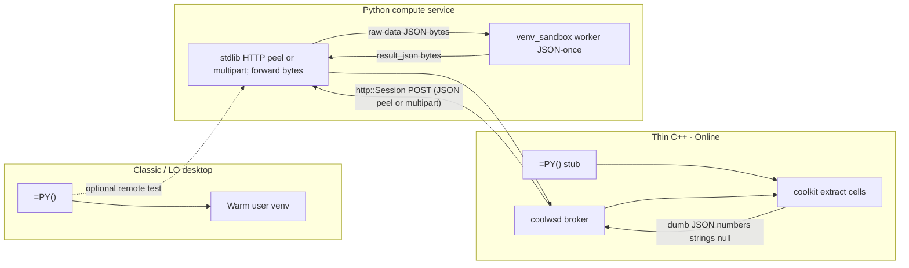

# Collabora Online and jail-safe execution

ER: [CollaboraOnline/online#16010](https://github.com/CollaboraOnline/online/issues/16010).

Related architecture comparison (AI chat / kit protocol, not Python compute): [../chat/collabora-online-ai.md](../chat/collabora-online-ai.md).
Companion documents: the rules every planner, coder, and reviewer must follow are in [collabora-engine-house-rules.md](collabora-engine-house-rules.md). This file keeps the architecture, the decisions behind it, and the history. Feature designs are in `docs/calc/` ([plot plan](../calc/collabora-engine-plot-plan.md), [spill plan](../calc/collabora-engine-spill-plan.md)).

## Product picture


| Product                                       | UI toolkit                                                 | Python / UNO                                                                                                                                   | Desktop `=PY()` today                                   |
| --------------------------------------------- | ---------------------------------------------------------- | ---------------------------------------------------------------------------------------------------------------------------------------------- | ------------------------------------------------------- |
| **Collabora Office Classic**                  | VCL (LibreOffice-based)                                    | Full PyUNO, extensions, macros — essentially desktop LibreOffice                                                                               | **Feasible as-is** (local warm venv)                    |
| **Collabora Online** (server)                 | Browser canvas                                             | Macros (incl. Python) off by default; admin must set `enable_macros_execution` in `coolwsd.xml`; scripts typically baked into the server image | **Blocked** — kit jail forbids spawn/shell/wide FS      |
| **Collabora Office (new desktop, Nov 2025+)** | Web UI (JS / Canvas / WebGL); same Online codebase lineage | Limited to running existing scripts; no full macro IDE or desktop extension UI                                                                 | **Same blocker as Online** — rewrite would benefit both |


Macros online were further constrained after [CVE-2025-24796](https://www.cve.org/CVERecord?id=CVE-2025-24796) (remote malicious macro execution); defaults keep execution disabled.

## Why the desktop design cannot enter the kit jail

The NumPy strategy ([§1](../enabling_numpy_in_libreoffice.md#1-the-problem-abi-and-embedded-python), [§2](../enabling_numpy_in_libreoffice.md#2-strategy-decision)) is deliberately a **separate interpreter**:

1. `ManagedSubprocess.start` (`subprocess.Popen`) **of a user venv** — `[PythonWorkerManager](../../plugin/scripting/venv_worker.py)` keeps a warm child talking Pickle5 over pipes ([IPC](numpy-serialization.md#worker-protocol)).
2. **Host filesystem** — resolve `scripting.python_venv_path`, put the extension tree on the child’s `sys.path`, and let trusted helpers open DBs/models.
3. **Flatpak escape** — `[wrap_command_for_sandbox](../../plugin/scripting/sandbox.py)` can use `flatpak-spawn --host` so the venv runs on the real host. That is the opposite of kit isolation.
4. **Desktop editor** — Monaco via **pywebview/Qt** needs a display and a child window; Online renders in a browser canvas.
5. **Long-lived shared kernel** — optional workbook namespace inside the warm process assumes a desktop process lifecycle, not an ephemeral per-document kit.

Collabora Online’s document work runs in a **jailed** `coolkit` **/ LOKit** child. That jail is not allowed to call arbitrary external programs, use the shell, or reach the wider filesystem. The warm-venv path depends on exactly those privileges.

**Hardening the AST sandbox inside the jail does not fix this.** The sandbox in `[venv_sandbox.py](../../plugin/scripting/venv/venv_sandbox.py)` is defense-in-depth for untrusted script *strings*; Online needs **OS-level isolation**, and the kit already provides it by *denying* the operations the desktop design needs for NumPy.

## Approaches that fail or are insufficient


| Approach                                         | Why it fails for Online / new desktop                                                                                                                                                |
| ------------------------------------------------ | ------------------------------------------------------------------------------------------------------------------------------------------------------------------------------------ |
| **Run the warm user-venv worker inside the kit** | Jail forbids fork/exec of arbitrary host Pythons and host venv paths; no `~/.writeragent_venv` story for multi-tenant cells.                                                         |
| `import numpy` **in LOKit’s embedded Python**    | Same [ABI crash risk](../enabling_numpy_in_libreoffice.md#1-the-problem-abi-and-embedded-python) as desktop in-process; one bad wheel can take the document kit with it; still no admin-curated scientific stack story. |
| **Only enable** `enable_macros_execution`        | Unlocks Basic/Python *playback* of image-baked scripts — not spawn of a user data-science stack or desktop extension UI.                                                             |
| **Pure-Python / Wasm-only cell runtime**         | Useful for light scripting; not a substitute for NumPy/pandas/scipy C-extension stacks.                                                                                              |
| **Ship pywebview Monaco into Online**            | Desktop windowing does not map onto browser canvas; Online already has a web UI surface for an editor.                                                                               |


**Jail-safe NumPy is not “put the current worker in a smaller box.” It is: do not run the scientific interpreter in the kit at all.**

## Proposed solution: native `=PY()` via thin C++ hooks → Python compute service

Track with Collabora: [online#16010](https://github.com/CollaboraOnline/online/issues/16010). Related AI/kit split (orchestration vs document mutation): [../chat/collabora-online-ai.md](../chat/collabora-online-ai.md).

**Goal:** real Calc **`=PY()`** on Online / new desktop (same formula surface as Classic — [§6](../enabling_numpy_in_libreoffice.md#6-the-py-calc-function)):

- **Small C++ hooks** in coolkit + coolwsd that call out to a Python compute service (same outbound-HTTP *shape* as AI chat’s `http::Session`).
- **All NumPy / packing / sandbox** stay in **Python** — C++ never implements [`split_grid`](numpy-serialization.md#strategy-3-split-grid-serialization-detail) or Pickle5.
- **Lightweight service** — **stdlib `http.server`** (or equivalent minimal HTTP) so coolwsd can POST (`application/json` peel today, or `multipart/form-data` when kit switches).

### Excel `xl()` compatibility is handled before execution

The Online bridge deliberately accepts the native, explicit-data surface `=PY(code, data…)`; it does not implement Microsoft's runtime `xl()` callback. Excel Python workbooks instead pass through the bidirectional rewriter in [`plugin/calc/excel_py_convert/`](../../plugin/calc/excel_py_convert/) (CLI, **auto-convert on open**, **ZipFile native export on save**; `=PY(...)` formulas **>1000 chars** use visible `py_code_<Sheet>` banks, shorter stay inline — full detail in [ms-py §5.8](ms-py-compatibility.md#58-ooxml--xlfnpy-import)):

```text
pythonScripts.xml:  df = xl(%P2%,headers=True)
worksheet cell:     _xlws.PY(0, 1, A1:C100)
                    │              │  └── %P2% = first trailing dep
                    │              └── returnType (headers= is on xl() in the script)
                    └── scriptIndex

%Pn% numbering: %P2% → first trailing dep, %P3% → second (idx = p_num - 2).

DAG code:           df = xl("%P2%",headers=True)   # sandbox xl looks up data / ranges
Calc formula:       =PY("..."; A1:C100)
```

(Bare `%Pn%` is quoted for valid Python; the sandbox injects a binding-only `xl` — [`excel_xl.py`](../../plugin/scripting/excel_xl.py). Legacy `data` / `.to_pandas()` DAG cells still reverse-export. Formula helpers are `calc.*`, not `xl`.)

This is important for both correctness and the jail boundary:

1. `A1:C100` becomes a real Calc formula precedent, so normal dirty tracking and DAG order still work.
2. coolkit extracts that already-declared range once and includes it in the request; Python `xl("%P2%")` only indexes that payload — no synchronous call back through service → wsd → kit.
3. The compute service remains document-blind: it receives code and plain values, not a capability for arbitrary live worksheet reads.

Excel scripts that share globals across multiple PY cells need a **shared** compute session so prior-stage Python names persist. The OOXML rewriter maps formula-static `xl()` ranges onto real `=PY` data precedents only; it does **not** inject synthetic prior-PY order edges (every trailing arg is a real binding). Enabling shared-kernel mode and managing run order is the operator’s responsibility (same advisory as LibrePy [§6](../enabling_numpy_in_libreoffice.md#session-modes-and-recalc-semantics)). A shared namespace without Calc precedents on real data ranges still will not refresh when those ranges change. `returnType` is preserved via conversion meta (`ExcelPyDagMeta` udprop on auto-open; CLI via `--from-report`). Table/`ANCHORARRAY` tokens are **A1 snapshots for Calc** and restored on Excel export for file fidelity only — not live Calc Table/spill support ([ms-py §5.8](ms-py-compatibility.md#58-ooxml--xlfnpy-import); code note in [`models.py`](../../plugin/calc/excel_py_convert/models.py)).

The rewriter handles formula-static references: fixed ranges, scalar cells, sheet-qualified table `[#All]` references, and `ANCHORARRAY`/spill anchors (the latter two become fixed A1 snapshots from workbook metadata). Microsoft does **not** productize true dynamic `xl(variable)` / `xl(f"A{n}")` (they fail in Excel). WriterAgent **fails closed** on those shapes if they appear (defense + not DAG-safe), and on missing table/anchor snapshots, rather than emitting shifted `data[i]` formulas. Sample fidelity: [`scripts/roundtrip_excel_py_samples.py`](../../scripts/roundtrip_excel_py_samples.py) over [`PythonExcelSamples/`](../PythonExcelSamples/).

Why `A3` inside `A1:A10` stays a separate precedent instead of being folded into the larger range is a research note of its own: [excel-xl-subset-fold.md](excel-xl-subset-fold.md). Short version: exact duplicate bindings are already collapsed; geometric subsets are not worth the value-shape and round-trip cost.



### Split of responsibility

| Layer | Language | Does | Does not |
|-------|----------|------|----------|
| Kit `=PY()` stub | C++ (small) | Register formula; on recalc read ranges via existing LOKit/cell APIs into **plain nested values**; send request up; apply returned scalar/matrix to cells | `split_grid`, Pickle, NumPy, AST sandbox |
| coolwsd | C++ (small) | Feature flag + URL config; `http::Session` POST/response routing (copy Online `AIChatSession` outbound HTTP) | Compute or dense packing logic |
| Compute service | **Python** | MIME-dispatch: peel today’s single JSON object **or** multipart `meta` + raw `code` + optional `init_script` + optional `data`; forward raw `data` bytes; worker loads once and dumps kit JSON once; host forwards those bytes. LibrePy desktop still uses [`payload_codec`](../../plugin/scripting/payload_codec.py) `split_grid` | Live inside kit jail |

**Dumb JSON** means cell values LO already exposes (float / string / empty / error string)—not LibrePy’s binary `split_grid` envelope. The compute host does **not** re-pack that JSON into `split_grid`; it forwards the `data` blob and the worker's `result_json`. The kit never loads NumPy.

### HTTP ingress: peel vs multipart

Same contract as [`compute_service/README.md`](../../compute_service/README.md#http-ingress-peel-vs-multipart). Both formats work **now**. Dispatch is strictly `Content-Type`.

| `Content-Type` | Body | Host does | Role |
|----------------|------|-----------|------|
| `application/json` (or missing) | One JSON object `{id?, code, data?, mode?, timeout_ms?, init_script?}` | Peel small keys; **forward the raw `data` value bytes** (no `json.loads` of the grid). Custom walker exists only so we do not deserialize the nested grid. | **Today’s Collabora/kit contract.** Transitional compatibility. |
| `multipart/form-data` (or other `multipart/*`) | Parts: `meta` (`application/json`: `id?`, `mode?`, `timeout_ms?`), `code` (raw UTF-8), optional `init_script` (raw UTF-8), optional `data` (raw JSON bytes) | Boundary-scan. `json.loads` **meta only** (64 KiB cap). Byte-cap and UTF-8-decode `code` and `init_script`. **Forward `data` bytes untouched** | **Preferred kit↔compute shape.** Control JSON, source, and the grid are separate MIME parts. |

`session_id` stays on the URL (`?session_id=...`) for L7 affinity — not in the request body (`meta` or the peel object).

**Why multipart:** cleaner framing (tiny control JSON vs source vs the grid blob). No custom JSON walker, and no JSON unescape of formula source on the HTTP host. Same “forward bytes, don’t re-serialize” win for the grid. That is the long-term wire between kit and this service. The MIME subset (named parts, CRLF or LF, no `base64` / `quoted-printable`) is in [`compute_service/README.md`](../../compute_service/README.md#http-ingress-peel-vs-multipart).

**Migration:** support both until Collabora/kit switches to multipart. After that, retire the single-JSON peel (the walker). Peel is **transitional compatibility**, not the forever design. No kit date — eventually switch kit to multipart, then delete peel. Today’s C++ `buildExecuteRequestJson` still emits the single-object peel body.

**Unchanged either way:** worker dumps kit JSON once (`result_json`); the HTTP host forwards those bytes (no host re-`dumps` of a large result). LibrePy desktop `=PY()` stays Pickle5 + `split_grid` both ways and never uses this HTTP hop.

### Python compute service

- Live tree: [`compute_service/`](../../compute_service/) (`server.py`, `wsgi_server.py`, `config.py`, `formula_worker.py`, [`json_forward.py`](../../compute_service/json_forward.py), [`json_egress.py`](../../compute_service/json_egress.py)); tests under `tests/compute_service/`.
- Listen with **`WSGIDualStackServer`** ([`compute_service/wsgi_server.py`](../../compute_service/wsgi_server.py)) on **`DualStackThreadPoolHTTPServer`** ([`plugin/framework/http_server.py`](../../plugin/framework/http_server.py)).
- `GET /health` → `{"status":"healthy","service":"python-compute","version":"<EXTENSION_VERSION>"}` where `version` is [`EXTENSION_VERSION`](../../plugin/version.py) (same as the WriterAgent OXT; unauthenticated for orchestrator liveness/readiness probes).
- `POST /v1/execute[?session_id=...]` accepts **both** ingresses (`Content-Type` dispatch). Peel of `{ "id?", "code", "data", "timeout_ms?", "mode?", "init_script?" }` is today’s kit contract and will be retired after kit moves to `multipart/form-data` (`meta` + raw `code` + optional `init_script` + optional raw `data`). Response `{ "id?", "status", "result"|"error", "stdout?", "images?" }` — worker-dumped, host-forwarded. Details: [`compute_service/README.md`](../../compute_service/README.md#http-ingress-peel-vs-multipart).
- `POST /v1/session/reset?session_id=...` — same Bearer auth as execute. `session_id` is **URL query only** (L7 sticky; reject if only in the JSON body). Optional body `{ "id?" }` is a correlation echo. Response `200` `{ "id?", "status": "ok" }` is **idempotent** (unknown / already-gone still `ok`). Reuses pool `reset_session` / LibrePy `reset_sandbox_session`. The supervisor drops its session map only when that worker reset returns `status: ok`; a failed reset is logged and the map stays, because the process may still hold the namespace. Intended caller: coolwsd on DocumentBroker destroy / last view leave. This lands ahead of Online shared; Online still hard-codes `isolated` and does not call reset yet. Idle TTL remains the safety net if reset is missed.
- **Dumb JSON egress only** toward kit/coolwsd: the worker dumps kit-safe JSON once (`allow_nan=False`, NaN/Inf → `null`); the HTTP host forwards those bytes. Plots go in top-level `images[]` (`format` + `data_b64`), not desktop Pickle envelopes.
- `mode`: `isolated` (default); `shared` requires a `session_id` URL query parameter (`?session_id=...`) to support router affinity and serializes executes per session with a lock.
- **Ops sidecar conventions**: Traps `SIGTERM`/`SIGINT` for clean socket draining; structured logging with request durations (`PYTHON_COMPUTE_LOG_LEVEL`); request `id` correlation echo.
- Reuse desktop sandbox: [`venv_sandbox`](../../plugin/scripting/venv/venv_sandbox.py), import blocklist (`policy_blocked_imports`/`DANGEROUS_MODULES`), curated Docker image (pinned numpy/pandas/**Pillow**/…).
- **`POST /v1/execute`** runs user code in a **bounded pool of formula worker subprocesses** ([`formula_pool.py`](../../compute_service/formula_pool.py); optional dedicated OCR workers when `ocr_workers > 0`). The HTTP listener stays in-process; crashes and timeouts are isolated in child processes.

### C++ hooks (deliberately dumb)

Live in the Collabora Online / LibreOffice trees (`collabofficefull`), not writeragent:

1. **Config** (`coolwsd.xml.in` / `ConfigUtil.cpp`, `<security><python_compute>`): `enable` (default `false`), `url`, optional `api_key` (Bearer), `timeout_secs` (default 60), `max_payload_bytes` (default 16 MiB; 0 or less means the default, so nothing is unbounded). No HTTP retries (formula POST is not idempotent). **No other knobs on purpose:** every other limit is a named constant or is derived from `max_payload_bytes`. A separate queue cap (`max_queued_requests`, 128) was considered and rejected.
2. **coolwsd** (`DocumentBroker`, broker thread, `ASSERT_CORRECT_THREAD`): kit `pythoncompute:` → `http::Session` POST (same outbound shape as AI chat) → result sent back as a **document-level** message, so closing a view does not lose it. Per document at most `MAX_PYTHON_COMPUTE_IN_FLIGHT` = 8 POSTs; more wait in a FIFO and are never refused. The request JSON is trimmed (`Util::trimmed`) so its byte count matches what `bridge.cxx` checked; over `max_payload_bytes` → `too_large`. Responses are capped while streaming with `setBodySizeLimit(max_payload_bytes)`. Every POST ends at `timeout_secs`. On teardown `shutdownPythonCompute` moves the in-flight map out, then calls `asyncShutdown` on each session and drops the queue. Each in-flight slot is released through a `weak_ptr<SocketPoll>`: the release only does `addCallback`, and the broker is locked inside the callback on the broker thread.
3. **kit** (`PythonComputeEmitter`, kit poll thread only): sets `COOL_PYTHON_COMPUTE` so the AddIn queues requests (elsewhere the cell shows `#DISABLED`). The AddIn's wakeup only does `addCallback`; the kit then calls `pythoncompute_take_requests()` without SolarMutex and hands results to `pythoncompute_complete()`, which takes Solar itself. Symbols are looked up (`dlsym(RTLD_DEFAULT)`, then `dlopen(NOLOAD)` for non-merged builds) until found, so a late-loaded AddIn is still served; `ensureWakeup` runs **only for spreadsheet documents** and has its own `catch`. MOBILEAPP no-op.
4. **Core AddIn (8122):** [`engine/scaddins/source/pythoncompute/`](file:///home/keithcu/Desktop/collabofficefull/engine/scaddins/source/pythoncompute/) (`addin` / `anyjson` / `bridge` / `volatile`) — UNO `org.collaboraoffice.sheet.addin.PythonComputeFunctions`, C++ ns `co::pythoncompute`, `getPy` / `getPython`, `XVolatileResult` interim `"#BUSY!"`, param→volatile weak-ref cache (identical args do not resend), **SolarMutex-only**. **No timer:** coolwsd answers every accepted request exactly once (result, error, or its own HTTP timeout). Limits, all from `max_payload_bytes`: a request over it is a transient `#VALUE!`; the kit is handed requests while those it holds without a result total ≤ 16 × payload (`kHandedOffPayloads`), the rest wait as `#BUSY!` and go oldest first; past max(1 GiB, 64 × payload) of held request JSON (`kHeldPayloads`, `kMinHeldBytes`) a new request is a transient error. Transient errors retry only after `kRetryAfterMs` (30 s), so an error cannot cause a recalc/request storm. Results decode with `comphelper::parseJsonToInferredAny` plus a strict UTF-8 string path; `null`, `[]` and `[[]]` all give an empty cell. List/grid results → `ScMatrix` (see [matrix / spill](#matrix-list-results--auto-spill-not-yet)).
5. **Future work:** see [below](#future-work-prototype--hardened-online). Monaco / browser cell editor remains a separate Online UI track (LibrePy uses pywebview; do not port that into the kit).

#### Cell markers / diagnosis (`#BUSY!`, `#DISABLED`, `#VALUE!`)

Volatile / finish values are **not** new Core `FormulaError` enum entries (Excel/Calc’s set stays fixed). Two existing Calc conventions coexist:

1. **True formula errors** — `CreateDoubleError` / void Any → cell `#VALUE!` / `#N/A`; Online `!` help + status bar show only fixed `GetLongErrorString` (e.g. “Error: No value”). Keeps `ISERROR` / `IFERROR`. **There is no free-form message field on `FormulaError`.**
2. **String markers** — plain `OUString` in the cell (same family as interim busy). Readable text, but **not** a formula error (`ISERROR` is false).

**Today (landed):**

| Cell shows | Kind | Meaning | Where |
|------------|------|---------|--------|
| `#BUSY!` | string | Request queued or in flight | AddIn before `pythoncompute_complete` |
| `#DISABLED` | string | Feature flag off | exact coolwsd error `"Python compute is disabled"` → literal in `jsonResultToAny` |
| `#VALUE!` | `FormulaError::NoValue` | Most `status=error`, bad JSON, missing `result` | opaque — **Python exception text is log-only** |
| `#N/A` | `FormulaError::NotAvailable` (void Any) | No emitter, pending timeout, superseded | Bridge lifecycle |

Service JSON `"error"` is parsed into `rError` and logged (`complete_json: detail=[…]`) then **discarded for the cell**. That is why a SyntaxError looks like every other `#VALUE!`.

**If `=PY()` shows `#DISABLED`:** turn on the flag in the **running** `coolwsd.xml` (or `--o:security.python_compute.enable=true`), restart coolwsd, and **reload the document** — the param→volatile cache can stick the finished disabled result until params change or the kit is fresh. Keep `coolwsd.xml.in` / ConfigUtil defaults **`false`** for git/upstream; local `coolwsd.xml` is the demo override.

Logs: coolwsd → `/tmp/coolwsd.log` (`Python compute: …`); Core AddIn → `export SAL_LOG=+INFO.scaddins.pythoncompute` or `+WARN.scaddins.pythoncompute` before starting coolwsd.

##### Planned: Python error detail in a look-aside (not implemented yet)

Authors need to **see** the Python failure cause. The cell must stay a true formula error so `ISERROR` / `IFERROR` keep working (Michael Meeks, 2026-11-09). `FormulaError` has no message field, so the text goes **beside** the cell, not in it: a per-document look-aside keyed by formula cell that the UI asks for the selected cell. The formula language does not change, and no function is added to read the detail.

An earlier draft put a short string in the cell (`ISERROR` false). That is rejected.

**Direction:**

| Cause | Cell | `ISERROR` | Detail in the look-aside |
|-------|------|-----------|--------|
| No emitter, pending timeout, superseded | `#N/A` | yes | none |
| coolwsd infra: timeout / network / empty URL / allowlist | `#N/A` | yes | the wsd reason; classify known `replyError` prefixes (today many of these still collapse to `#VALUE!`) |
| `"Python compute is disabled"` | `#DISABLED` | no | none. Kept as a string on purpose: it should not happen on a configured system, and it says the system is off, which the author cannot fix in Python |
| Service `status=error` with a message (Python exception text, etc.) | `#VALUE!` | yes | the message; later the trimmed traceback and stdout |
| Bad JSON / missing `result` / empty error | `#VALUE!` | yes | none (no useful message) |
| Empty `code` | `Err:502` | yes | already `IllegalArgumentException` |

Where the text travels and where it is read is in [F6](#f6--python-error-detail-look-aside). Do **not** add new `FormulaError` enum values.

#### Matrix / list results / auto-spill (not yet)

JSON lists already convert to `sequence<sequence<double|Any>>` → `ScUnoAddInCall::SetResult` builds `ScMatrix` → interpreter `PushMatrix`. That path is real.

**Single-cell `=PY(...)` does not auto-spill.** If the formula was not entered as a matrix / dynamic-array formula, Core keeps **only the top-left** value and drops the rest:

```text
// engine/sc/source/core/data/formulacell.cxx (~2577–2582)
// If the formula wasn't entered as a matrix formula, live on with
// the upper left corner and let reference counting delete the matrix.
```

`=PY` is also not a Core “matrix function” for UI auto-dynamic-array promotion (`rpnIntendsArrayResult`), so typing `=PY("result = [1,2,3]")` + Enter yields **`1`**, not a spill of three cells and not `#VALUE!`.

| Case | Online AddIn today | LibrePy Classic |
|------|--------------------|-----------------|
| Single-cell → list/2D | Top-left only | `scripting.python_auto_spill` writes neighbors + `#SPILL!` |
| Ctrl+Shift+Enter matrix block | Full `ScMatrix` into declared range | matrix / index / spill paths |

**Future (do not forget — comments/README in tree when touching anyjson):** single-cell auto-spill for Online AddIn `PY` requires Core dynamic-array promotion for the AddIn (Classic extension-style UNO write-back does not belong in Core). Not required for Gerrit of the thin tip. Full design note and code pointers: [Collabora Engine Spill Plan](../calc/collabora-engine-spill-plan.md). Track as [F7](#f7--single-cell-auto-spill).

### Security invariants

1. **Compute is out-of-kit** — kit compromise ≠ host Python; Python compromise ≠ kit filesystem/network (seccomp, no capabilities, no docker.sock).
2. **Admin-baked image** — packages like Online macros today; **not** arbitrary tenant `pip` in multi-tenant Online.
3. **Per-document / per-session isolation** — no shared kernel across tenants; shared kernel only within one document session if enabled.
4. **Default deny** — no outbound network, no host mounts, scratch-only FS, hard CPU/RAM/wall-clock quotas.
5. **Separate feature flag** from `enable_macros_execution`.
6. **Import blocklist** inside the container (`policy_blocked_imports`/`DANGEROUS_MODULES` via [`venv_sandbox.py`](../../plugin/scripting/venv/venv_sandbox.py)) as defense-in-depth; OS isolation is the real boundary.

### Product matrix

| Product | Execution backend | Editor |
|---------|-------------------|--------|
| **Collabora Office Classic** + stock LibreOffice | **Local warm venv** (shipped) | Monaco via pywebview, or native dialog fallback |
| **Collabora Online** + **new web desktop** | **Python Compute Service** via thin coolwsd hooks | Browser Monaco / Online UI (no pywebview) |

Same `=PY(code, data…)` / `result =` semantics; different backends.

### Classic remote testing (optional)

Same HTTP API: a `RemoteComputeBackend` behind [`run_code_in_user_venv`](../../plugin/scripting/venv_worker.py) can POST dumb lists (or run local pack and use the service only for execute) so the **service** can be debugged without an Online rebuild.

### Explicit non-goals for the C++ tip

- No C++ port of [`payload_codec.py`](../../plugin/scripting/payload_codec.py) / `split_grid`
- No embedding user venvs or NumPy inside the kit jail
- No heavy Python web frameworks for the compute service

### Layout / build order

```
writeragent/
  compute_service/     # NEW — stdlib HTTP + sandbox + Dockerfile
  plugin/scripting/    # optional RemoteComputeBackend for Classic

collabora-online (kit/wsd)/
  kit/                 # =PY stub + dumb JSON extract/apply
  wsd/                 # feature flag + http::Session to python_compute_url
  coolwsd.xml.in       # enable_python_compute, python_compute_url
```

1. Python compute service + Dockerfile + tests against JSON grids.
2. Classic `RemoteComputeBackend` against the service (fast Python-only iteration).
3. C++ hooks: kit stub + coolwsd broker → wire works (`pythoncompute:` / `pythoncomputeresult:`; debug `pythonexecute`). **Landed in tree** — remaining submit gaps in [Still open before Gerrit](#still-open-before-gerrit).
4. Core `=PY()` AddIn + `#BUSY!` volatile + list→`ScMatrix` (single-cell = top-left only). **Landed in tree** (scaddins `pythoncompute` + kit emitter). Rebuild LibreOffice (`libpythoncomputelo.so`) + Online coolkit to pick up.
5. Future work below — NumPy smoke, plots / remaining container hardening / shared kernel, **Python error detail look-aside (F6)**, **auto-spill (F7)**. UnitWSD CI is done; caps / isolation / series still outrank F3–F5 for Collabora review.

Until Collabora ships images with Step C linked **and** the remaining open items below are acceptable for an experimental merge, **Classic** remains the product where full desktop NumPy `=PY()` works end-to-end without a Core rebuild.

---

## Future work (prototype → hardened Online)

AddIn `timeout_ms` emission is **deferred** (wsd defaults 60s; service clamps; pending map 90s). Browser Monaco / Edit-Python-in-cell for Online is **out of this list** (LibrePy pywebview is Classic-only).

### Ordered slices

| # | Slice | Status | Where |
|---|-------|--------|-------|
| F1 | UnitWSD wire CI | **done** | `test/UnitPythonCompute.cpp` |
| F2 | Scalar NumPy smoke | manual procedure below | writeragent + local coolwsd |
| F3 | `images[]` sheet insert | **implemented on `feature/python-compute-plot-images`**, not yet on Gerrit | Core AddIn + `sc` draw layer; design in the [plot plan](../calc/collabora-engine-plot-plan.md) |
| F4 | Compute container hardening | done except ops (cgroup, private network) | `compute_service/Dockerfile` + run scripts |
| F5 | Shared workbook kernel | service side done; coolwsd caller not shipped | AddIn + kit + service |
| F6 | Python error detail (look-aside; cell stays `#VALUE!`) | design revised 2026-11-09, not coded | Core AddIn + `sc` per-cell store + two read points |
| F7 | Single-cell auto-spill | **implemented on `feature/python-compute-engine-spill`**, not yet on Gerrit | Core `sc`; design in the [spill plan](../calc/collabora-engine-spill-plan.md) |

---

### F1 — UnitWSD wire test — **done**

`test/UnitPythonCompute.cpp` (registered in `test/Makefile.am` as `unit-python-compute.la`) reuses the UnitWSD/WOPI listener as the local `/v1/execute` stub, so CI proves kit → wsd → HTTP → `pythoncomputeresult:` without writeragent or a real service. It covers enabled and disabled routing, the zero-POST disabled invariant, request and response caps, FIFO behind 8 in flight, close mid-flight, a result after its view closed, a silent service, 500, non-JSON, a refused connection, and the `PlotImages` cell-text scenario. It asserts cell text only; it cannot see draw objects. Run it with `scripts/run-wsdunit unit-python-compute`.

---

### F2 — Scalar NumPy smoke (manual / scripted demo)

**Goal:** One command path a Collabora engineer can run that shows `import numpy` succeeding **only** in the service process.

**Procedure (local):**

1. From writeragent: `python compute_service/server.py` (or `docker build -f compute_service/Dockerfile` + run `-p 8000:8000`). Confirm `GET /health` → `{"status":"healthy"}`.
2. coolwsd config (overrides):
   ```xml
   <python_compute desc="…" enable="true">
     <url desc="…" default="http://127.0.0.1:8000/v1/execute"></url>
   </python_compute>
   ```
   Keep `security.python_compute.enable` **false** in ConfigUtil defaults; only the running `coolwsd.xml` enables it for the demo host.
3. Rebuild / install Online kit that embeds Step C (`libpythoncomputelo.so` on the kit `LD_LIBRARY_PATH` / LO foundation). Without it, `=PY()` finishes immediately with `"Python compute unavailable"`.
4. Open Calc Online, enter:
   ```text
   =PY("import numpy as np; result = float(np.sum([1,2,3]))")
   ```
   Expect interim `#BUSY!`, then `6`.
5. Process proof: `ps` / container logs show numpy import in the **service** PID, never in `coolkit`. Optionally add a temporary log line in `compute_service/formula_worker.py` on successful `import numpy` in the sandbox namespace.

**Wire-only without formula:** browser/devtools WS:
```text
pythonexecute {"id":"smoke1","code":"import numpy as np\nresult = float(np.pi)"}
```
then watch `pythoncomputeresult:` (echo or volatile-complete).

**Keep scripts next to the service:** e.g. `compute_service/smoke_online.md` or a small shell that curls `/v1/execute` first (sanity), then prints the coolwsd XML snippet. Do not bake NumPy into Online's unit harness for F2.

**Done when:** documented smoke path works on a developer machine in <15 minutes without matrix spill expectations.

---

### F3 — Online `images[]` / plot insert

**Status: implemented on `feature/python-compute-plot-images` (base 8123 PS29, `7b5ad8d25d28`); not yet on Gerrit.** The earlier sketch here (decode in the kit, `.uno:InsertGraphic`, PNG only, an 8 MiB cap) was wrong and is gone: the kit path inserts at a view cursor, `=PY()` is async and multi-view, and the brief forbids new caps.

What landed, in one paragraph. The AddIn passes `images[]` bytes through untouched on a new `XPythonComputePlotResult` interface of the volatile; the cell value is still the scalar or matrix result, or the string `Image inserted` / `Images inserted` when `result` is null. The interpreter records the plots it sees and the formula cell queues a sync when its interpret finishes; syncs flush with the pending matrix resizes after the outermost interpret, never inside the formula engine. A plot is an `SdrGrafObj` anchored to the formula cell with the new `ScDrawObjData::Type::PythonPlot`; its owner is the start of its non-rotated anchor, the reserved name `PythonComputePlot[_N]` carries only the slot. A recalc replaces pictures in place and keeps the user's geometry; a cell that stops being a `=PY()` (or whose interpret no longer reaches `PY()`) loses them; a transient error keeps the last plot, a deterministic one removes it; an undecodable image keeps its slot as an empty-graphic placeholder. Row and column delete, sheet operations, cut, paste, merge and formula-to-value take the plot along and undo in one step. A plot the user groups, renames, re-anchors or copies becomes an ordinary picture. The type is runtime-only; ODS import re-derives it from the name and the start cell, XLSX does not.

Design and decisions: [collabora-engine-plot-plan.md](../calc/collabora-engine-plot-plan.md). The accepted limitations and the lifecycle matrix travel with the branch and go into the commit message at landing. Tests: `sc_ucalc`, `sc_anchor_test`, `sc_tiledrendering`, `scaddins_pythoncompute`, `unit-python-compute` (`PlotImages`).

Lesson recorded in the [house rules](collabora-engine-house-rules.md): this feature took eleven single review rounds and four parallel rounds because identity was first keyed on a shape name plus the main anchor, both of which Calc rewrites on ordinary paths, and because the lifecycle matrix was discovered one cell per round instead of written in the plan.

---

### F4 — Compute service container hardening

**Status: Dockerfile hardening + loopback/dual-stack bind configurations landed.**

**Goal:** Make the security invariants in this doc **operational**, not aspirational. The kit jail is only half the story; a compromised compute container must not become host RCE.

**Implemented:**

1. **Configurable / Safe Binding**: `server.py` defaults to binding to `127.0.0.1` (loopback only) instead of wildcard, preventing external exposure by default. It supports configuring the host via the `PYTHON_COMPUTE_HOST` environment variable.
2. **Dual-Stack & IPv6**: `WSGIDualStackServer` binds using a dual-stack configuration (`DualStackThreadPoolHTTPServer`), allowing concurrent IPv4 and IPv6 connections on supported systems with graceful fallback.
3. **Multi-stage Dockerfile**: The [`compute_service/Dockerfile`](../../compute_service/Dockerfile) installs the pinned stack with `pip --only-binary=:all:` into `/app/pkgs`. Neither stage installs a compiler. A source build would link against libraries the runner never copies. The runner image has no compiler, which keeps that attack surface out of the runtime container.
4. **Startup Dependency Check**: The server runs a pre-check to ensure required libraries like `sympy` are importable, failing fast at startup if dependencies are missing.
5. **Runtime flags (recommended for ops):**
   ```bash
   docker run --init --read-only --tmpfs /tmp:rw,size=64m,mode=1777 \
     --memory=1g --cpus=1 --pids-limit=256 \
     --security-opt no-new-privileges \
     --cap-drop ALL \
     --network <internal-bridge-only> \
     -p 127.0.0.1:8000:8000 \
     …
   ```
   coolwsd on the host reaches `127.0.0.1:8000`; the container has **no** route to the public internet (tenant `urllib` / sockets die). If the sandbox AST already blocks many imports, network isolation is still the real boundary for C-extension sockets.
6. **No docker.sock, no privileged, no host FS mounts** of tenant data. Scratch only under `/tmp`. If models/weights are needed later, bake into the image (admin curates) — never bind-mount `~/.writeragent_venv`.
7. **Auth between coolwsd and service:** coolwsd sends optional `security.python_compute.api_key` as `Authorization: Bearer …`. The compute service verifies that Bearer only when a key is configured (`PYTHON_COMPUTE_API_KEY` / key file / `python-compute.json`); empty key = no auth (dev/test). Remaining ops: cgroup/network isolation ([F4](#f4--compute-service-container-hardening) / G5).
8. **Resource quotas already partially exist:** `timeout_ms` / `clamp_timeout_sec` in [`config.py`](../../compute_service/config.py) and [`formula_worker.py`](../../compute_service/formula_worker.py); add RSS watch or rely on cgroup `--memory`. Document that wall-clock alone does not stop a malloc bomb — cgroup does.
9. **Health / readiness:** keep `/health` (`status`, `service`, `version`); orchestrators use it. The image `HEALTHCHECK` calls that route with the Python stdlib (the base image has no curl). Do not expose `/v1/execute` without the allowlist auth once enabled.
10. **Signal handling & structured logging:** `SIGTERM`/`SIGINT` graceful shutdown for orchestrators; structured logging with request durations and configurable verbosity (`PYTHON_COMPUTE_LOG_LEVEL`). Request `id` is echoed on success and error payloads for async tracing.


---

### F5 — Shared workbook kernel (`mode:shared` + `session_id`)

**Today:**

- Service [`execute_code`](../../compute_service/formula_worker.py) already honors `mode=="shared"` + non-empty `session_id`, with a per-id `threading.Lock`.
- Service `POST /v1/session/reset?session_id=...` reuses [`FormulaProcessPool.reset_session`](../../compute_service/formula_pool.py) → worker `action: reset_session` → LibrePy [`reset_sandbox_session`](../../plugin/scripting/venv/venv_sandbox.py). Query-only `session_id`; idempotent `ok`; the session map is dropped only when the worker reports `status: ok` (a failed reset keeps the map). Idle TTL (`idle_worker_ttl_sec`) stays the safety net. This is **service-side only** — the coolwsd caller is not shipped. Online still hard-codes isolated. A second shared execute or reset waits at most its own clock on the pool session gate (execute: remaining deadline; reset: `timeout_sec`) and returns `WORKER_POOL_BUSY` on a miss; the in-flight cell keeps the gate entry.
- Online AddIn [`buildExecuteRequestJson`](file:///home/keithcu/Desktop/collabofficefull/engine/scaddins/source/pythoncompute/anyjson.cxx) **hard-codes** `"mode": "isolated"` (via `tools::JsonWriter`) and never sends `session_id` / `init_script`. That emit is the **peel / single-JSON** ingress (today’s contract). Compute already accepts `multipart/form-data` too (`meta` + raw `code` + optional `init_script` + optional `data`); when kit switches to multipart, peel retires. See [HTTP ingress: peel vs multipart](#http-ingress-peel-vs-multipart).
- LibrePy derives workbook ids via [`session_manager.calc_workbook_base_session_id`](../../plugin/scripting/session_manager.py) and seeds init scripts from document properties.

**Online design constraints:**

- **Never** share a kernel across tenants / DocumentBrokers. `session_id` must include something unique to the doc instance coolwsd already trusts (e.g. docKey / jail id / `DocumentBroker::getDocKey()`), **not** a client-supplied string from formula text.
- Kit compromise forging `session_id` is OK only if coolwsd **overwrites** the id on the way out (wsd is the trust boundary for tenancy).

**Implementation sketch:**

1. **Config:** `security.python_compute.session_mode` = `isolated` \| `shared` (default isolated). Separate from macros. Matching LibrePy setting conceptually, but admin-global for Online v1 (per-doc UI later).
2. **coolwsd `handlePythonComputeFromKit`:** after parsing JSON, if shared mode:
   - Set `mode` to `shared`.
   - Set `session_id` to a server-derived string, e.g. `py:` + docKey (+ view id **not** included — workbook-scoped like Classic).
   - Strip any client/kit-provided `session_id` (ignore untrusted).
   - Optionally inject `init_script` once per docKey (cache flag on DocumentBroker) by reading a document property via an existing kit command if available; v1 can skip init and only share namespace across `=PY` cells.
3. **AddIn:** keep emitting isolated always **or** emit `mode` omit and let wsd decide — prefer **wsd owns mode** so a rebuilt AddIn is not required to flip admin policy.
4. **Lifecycle:**
   - On DocumentBroker destroy / last session leave: coolwsd `POST /v1/session/reset?session_id=<id>` (service endpoint is landed; **coolwsd caller is not**). Query-only `session_id` (same L7 sticky as execute). Idempotent `ok` if the kernel is already gone. Do not put `session_id` in the JSON body. The map is dropped on `ok`, and a missed reset is reclaimed when the worker has been idle for `idle_worker_ttl_sec`.
5. **Recalc semantics:** document Online limitation — without Excel-style co-volatility, multi-cell shared-kernel scripts need real `data` precedents for dirtying and operator-managed run order (same advisory as LibrePy §6; the OOXML rewriter does not invent prior-PY edges). Do not invent Online co-volatility in v1.
6. **Tests:**
   - Service unit: two sequential executes with same `session_id` share a name; different ids do not.
   - UnitWSD: enable shared; `pythonexecute` twice with `code` setting then reading a global; assert second sees first; second docKey does not.

**Multi-tenant footgun:** if anyone ever points two coolwsd instances at one compute service without unique docKeys globally, kernels can collide — prefix with deployment id / hostname in `session_id`.

**Done when:** admin can flip shared mode and two `=PY` cells in one Online doc share `x = 1` / `result = x + 1` without shipping LibrePy into the jail.

---

### F6 — Python error detail (look-aside)

**Revised 2026-11-09.** The earlier F6 put a short string in the cell with `ISERROR` false. Michael Meeks asked for the opposite: the cell is a real error (`ISERROR` true) and the diagnostics live in a look-aside buffer that can be asked for a specific cell, without changing the formula language.

**Goal:** When `=PY()` fails with a Python/service message, the cell stays `#VALUE!` and the author can read the message for that cell in the UI.

**Why the text cannot ride in the cell:** Calc packs errors as `FormulaError` in a NaN (`CreateDoubleError`). Display is fixed short/long strings (`GetErrorString` / `GetLongErrorString`). A string in the cell is readable but is not an error, so `ISERROR` / `IFERROR` break. Exception text is already parsed into `rError` and logged, then discarded today.

**Where the information goes** (same route as plots, [F3](#f3--online-images--plot-insert)):

1. **AddIn.** `bridge.cxx` already holds the text (`sErr`) when a request completes. Hand it to the volatile with the result, as plots are, and expose it on a side interface beside `XPythonComputePlotResult`. The AddIn still does not know the cell.
2. **Interpreter.** `ScInterpreter::ScExternal` (`sc/source/core/tool/interpr4.cxx`) already queries the volatile for plots. It reads the detail at the same place. This is the point that knows the cell.
3. **Store.** When the formula cell finishes its interpret, `ScDocument` keeps the detail per formula cell, the same shape as `maPythonPlots`. A later success, a cell that stops being a `=PY()`, or a deleted cell erases the entry. A copied cell copies it. It is runtime-only and is not saved; a recalc on load fills it again.
4. **Read points (both exist, both know the cell):**
   - `sc/source/ui/app/inputhdl.cxx` sends `CellFormulaError` with `errorDescription` for the selected cell. Online draws it in `FormulaErrorHelpSection.ts`. Use the store's text when the cell has an entry, else `GetLongErrorString` as today.
   - The status bar text for the cursor cell is requested in `sc/source/ui/view/cellsh.cxx` (`SID_TABLE_CELL`) and built from `GetLongErrorString` in `tabvwsha.cxx`. Same lookup at the call site, so Classic shows it too.

   No new protocol message and no browser change for this step.
5. **Later.** When the service sends a trimmed `traceback` and `stdout`, they go in the same entry, and the diagnostics sidebar lists the store by cell address. That listing is the only new protocol surface, and it is a separate patch.

**Other rows of the matrix:**

1. **Infra** (timeout, network, no emitter, allowlist, empty URL) → `FormulaError::NotAvailable` → `#N/A`. Classify known coolwsd `replyError` prefixes in `jsonResultToAny` (several of these still become `#VALUE!` today).
2. **Disabled** → keep the `#DISABLED` string. Special case: the system is off; it is not a Python error.
3. **Parse / missing result / empty error** → keep `#VALUE!`, no entry.
4. Keep the log line (`complete: detail=[…]`).

**No new cap:** the message is already bounded by `max_payload_bytes` on the response. The UI shortens what it draws; the store keeps what arrived.

**Files:** `engine/scaddins/source/pythoncompute/` (`bridge.cxx`, `volatile.*`, IDL for the side interface), `engine/sc/` (`interpr4.cxx`, `formulacell.cxx`, `document.hxx` + store, `inputhdl.cxx`, `tabvwsha.cxx`), CppUnit in `engine/scaddins/qa/pythoncompute.cxx`, ucalc.

**Out of scope for F6:** new `FormulaError` enum values, any text in the cell, a formula function that returns the detail, the sidebar.

**Depends on:** the plot branch (it adds the interpreter hook and the per-cell store pattern).

**Done when:** `=PY("result = 1/0")` shows `#VALUE!`; `ISERROR` of that cell is true; selecting it shows `ZeroDivisionError: division by zero` in Online's error help and in the status bar; fixing the code clears the entry; timeout is `#N/A`; disabled is still `#DISABLED`; CppUnit and ucalc cover the matrix above.

---

### F7 — Single-cell auto-spill

**Status: implemented on `feature/python-compute-engine-spill` (base 8123 PS29); not yet on Gerrit.** One check in `intendsArrayResultInRange` promotes a UI-entered `PY` / `PYTHON` to a 1×1 dynamic-array master before interpret, so Calc's existing spill path runs; a later scalar or error collapses the spill, the interim `#BUSY!` string does not. The extension-style deferred UNO write-back used by Classic (`scripting.python_auto_spill`) was rejected for Core. Design: [collabora-engine-spill-plan.md](../calc/collabora-engine-spill-plan.md).

---

### Explicitly deferred (not proto-blocking)

| Item | Why deferred |
|------|----------------|
| AddIn-emitted `timeout_ms` | WSD admin `timeout_secs` (default 60s); service clamps; pending map 90s |
| Browser Monaco / cell editor | Separate Online UI project; LibrePy pywebview is Classic-only |
| C++ `split_grid` / Pickle5 | Violates the dumb-JSON tip on purpose |
| Kit-side NumPy / warm venv | Jail-incompatible by design |
| Python error detail for a cell | **Deferred — look-aside design, not coded.** Text in the cell is rejected (`ISERROR` must stay true). See [cell markers](#cell-markers--diagnosis-busy-disabled-value) + [F6](#f6--python-error-detail-look-aside). Today: detail log-only; cell `#VALUE!` / `#N/A` / `#DISABLED` |
| Single-cell auto-spill | On the spill branch, not on Gerrit. See [F7](#f7--single-cell-auto-spill). On 8123 itself: top-left only |
| Per-document cache keying | Process-wide weak-ref identity map (soft cap 256, never evicts live entries); cleared on kit teardown — no per-`ScDocument` map (AddIn has no doc pointer; Core shares one volatile across docs) |

---

## Still open before Gerrit

Architecture (out-of-kit compute, thin C++ tip, default-off flag, host allowlist) is the right shape and the 2026-07 correctness / multi-view / MOBILEAPP / typed JSON items are done in tree. What is left is below; scope anything not addressed as an experimental follow-up in the cover letter.

### Open checklist

| # | Topic | Status |
|---|--------|--------|
| G4 | Size / in-flight caps | **Done** — one `max_payload_bytes` (AddIn + wsd), 8 in flight + FIFO, `timeout_secs`, `asyncShutdown` on close; service-side `max_body_bytes` / `max_code_chars` too. See [G4](#g4--resource-caps--done) |
| G5 | Service isolation | Bearer verify when key set; empty key = open (dev); cgroup/network isolation still ops — [F4](#f4--compute-service-container-hardening) |
| G6a | Pending timeout is passive | Superseded — the AddIn has no timer; wsd answers every accepted request once (incl. its own HTTP timeout) |
| G6c | LRU breaks AddIn.idl identity; sticky errors | Done — weak-ref identity map never evicts live entries; sticky retry = change params (documented) |
| G8 | UnitWSD / formula-level CI | UnitWSD done; full formula-level Online CI remains optional follow-up |
| G9 | Series / hygiene | Hygiene done; series preparation remains intentionally pending |
| G10 | Python message not readable anywhere but the log | Open / deferred — `#VALUE!` itself is right; the look-aside in [F6](#f6--python-error-detail-look-aside) is not coded |
| G11 | No single-cell auto-spill | Implemented on the spill branch ([F7](#f7--single-cell-auto-spill)); 8123 itself is top-left only |

Remaining nits from the same reviews: the display name `PY` vs Excel semantics needs an IDL / release-note sentence; AddIn help strings are en-US only (no `.hrc`); `SAL_DLLPUBLIC_EXPORT` on `anyjson` test helpers should become C-ABI-only exports eventually.

### Any↔JSON (dumb JSON note)

**Landed in tree** as the Core ↔ service dialect (keep for contracts / F3 plots / shared kernel). **Do not merge** this into jsuno: typed `appendUnoAsJson` / `parseJsonToAny` (optional QuickJS) is a different contract. Keep Poco in coolwsd. `tools::JsonWriter` is already the shared encoder. See [Do not regress](#do-not-regress-meeks-2026-08).

- **Emit:** `tools::JsonWriter` in `anyjson.cxx` — Calc ranges as `Sequence<Sequence<…>>` first, then flatten 1×N / N×1 when useful (Any **and** typed double grids).
- **Parse:** local hand parser in the same file (not `boost::property_tree`, not Boost.JSON, not Poco in Core). It combines UTF-16 surrogate pairs, rejects unpaired surrogates/trailing junk, and rejects ragged nested arrays. Online coolwsd stays on Poco/`JsonUtil`.
- **Scalars:** JSON `"42"` / `"true"` / `"null"` stay strings; bare `42` / `true` / `null` → double / bool / empty string (Classic `None` parity).
- **Grids:** nested lists; rectangular numerics → `sequence<sequence<double>>`; mixed → `sequence<sequence<Any>>`; one-element lists of every scalar type stay 1×1 matrices. Single-cell formulas keep **top-left only** until [F7](#f7--single-cell-auto-spill).
- **Envelope:** `id`, `status`, `error`, `result`, optional `images[]` (sheet insert still [F3](#f3--images-sheet-insert); Core shows a placeholder string today). Request emit today is one JSON object (peel path). Service also accepts multipart; kit will switch later — [HTTP ingress](#http-ingress-peel-vs-multipart).
- **Tests:** `engine/scaddins/qa/pythoncompute.cxx` + writeragent `tests/compute_service/test_online_py_json_contract.py`.

### G4 — Resource caps — **done**

One admin setting, `security.python_compute.max_payload_bytes` (default 16 MiB), bounds both ends:

| Where | Limit |
|---|---|
| AddIn, request out | over `max_payload_bytes` → transient `#VALUE!` (retry after 30 s) |
| AddIn → kit hand-off | ≤ 16 × payload held by the kit without a result; the rest wait `#BUSY!`, oldest first |
| AddIn memory backstop | past max(1 GiB, 64 × payload) held request JSON → transient error |
| wsd, request | trimmed JSON over `max_payload_bytes` → `too_large` (same byte count as `bridge.cxx`) |
| wsd, response | `setBodySizeLimit(max_payload_bytes)` while streaming |
| wsd, concurrency | 8 POSTs in flight per document (`MAX_PYTHON_COMPUTE_IN_FLIGHT`); FIFO behind it, never refused, needs no cap because the hand-off budget bounds it |
| wsd, time | `timeout_secs` (default 60) ends every POST |
| wsd, close | in-flight sessions `asyncShutdown`, queue dropped |

**Policy:** no extra knobs. The 128-entry `max_queued_requests` cap was rejected: the byte budget already bounds the queue, and a count cap would only add a `busy` failure mode. Known edge (accepted, low): `asyncShutdown` flushes rather than cancels, so a POST still connecting at close may reach the service; the document is gone by then.

### G5 — Service isolation

Auth and bind are done: loopback-only default (`127.0.0.1`), multi-stage Dockerfile, optional `security.python_compute.api_key` Bearer verified service-side when set (empty key = open, dev only). Config is standalone (`PYTHON_COMPUTE_*` / `python-compute.json`). Still ops work, not code: cgroup `--memory` / `--cpus`, private bridge network, no `docker.sock` ([F4](#f4--compute-service-container-hardening)). Do not claim the AST sandbox is the OS boundary.

### G6 — Lifecycle — **done / superseded**

The AddIn has no timer: coolwsd answers every accepted request exactly once (result, error, or its own `timeout_secs`), and the kit and document go away together (G6a). The param cache is a process-wide map of `unotools::WeakReference`s that never evicts a live entry, so identical params return the same `XVolatileResult` without a second POST; `kParamCacheSoftCap` (256) only prunes lapsed weaks; a pending timeout erases its key so the next recalc re-emits; a missing emitter is a one-shot `#N/A` and is not cached; finished success and service errors stay sticky (G6c). CppUnit: `test_paramCacheIdentityUnderPressure`, `test_paramCacheDropsLapsedWeak`, `test_noEmitterThenEmitterRetries`, `test_pendingTimeoutThenRetryEmits`, `test_pendingTimeoutWithoutRecalc`.

### G8 — Test coverage gaps

Core CppUnit now also covers Unicode surrogate pairs, one-element string/bool matrices,
mixed numeric/string rows, rectangular columns, ragged-array rejection, and trailing/invalid
JSON. UnitWSD covers enabled/disabled routing, the local POST, response id/status/result, and
the zero-POST disabled invariant. Remaining coverage gaps:

| Area | Missing today |
|------|----------------|
| UnitWSD | allowlist reject; direct corrupt upward-frame injection (production handler now replies with structured error) |
| Lifecycle | disconnect mid-flight (timeout-without-recalc covered by AddIn CppUnit) |
| Limits | covered: `unit-python-compute` tests request and response caps, close mid-flight, FIFO behind 8 in flight, a result after its view closed, a silent service, 500, non-JSON, refused connection |

[F1](#f1--unitwsd-wire-test-pythonexecute--post--pythoncomputeresult) is implemented and registered with the Online unit suite.

### G9 — Series, naming, and hygiene

The review notes from Meeks (2026-08) and Tomaž (2026-09, 2026-10), the Cursor `Co-authored-by` commit recipe, and the series shape now live in [collabora-engine-house-rules.md](collabora-engine-house-rules.md) (sections 3 and 9). Hygiene is done in tree; the series split (generic Calc fixes, Core AddIn, Online kit/wsd, feature branches) is prepared when Keith asks for it.

### Reviewer-facing cleanup

Done: fixed-width `int32_t` C ABI, `writeAnyValue` factoring of the JSON writers, corrected IDL volatile comment, engine subtree README. Open: `IwyuFilter_scaddins.yaml` if CI enables IWYU; en-US help accepted for v0.1 with a PR note.

### What already looks good (keep)

- Out-of-kit compute; C++ tip free of NumPy / `split_grid` / Pickle5.
- `security.python_compute.enable` default `false`; optional `api_key` / `timeout_secs`; `HostUtil::isForbiddenKitHost` when allowlist set.
- UNO package `org.collaboraoffice.sheet.addin.*` (not `com.sun.star.sheet.addin` for this AddIn).

### File interop with LibrePy / WriterAgent (desktop)

Calc stores add-in formulas as **OriginalName** (`ServiceName.MethodName`), not display `=PY()`. Collabora cells are `ORG.COLLABORAOFFICE.SHEET.ADDIN.PYTHONCOMPUTEFUNCTIONS.GETPY(...)` (IDL `getPy`). LibrePy registers `org.extension.writeragent.PythonFunction` / `py` — a different token — so those files `#NAME?` unless rewritten.

LibrePy **does not** register Collabora's UNO service (that would add a second Function Wizard name and collide with Collabora Office Classic). On `OnLoadFinished` it prefix-rewrites `GETPY`/`GETPYTHON` to `=PY(`/`=PYTHON(` so the existing add-in runs. Code: [`plugin/calc/python/collabora_formula.py`](../../plugin/calc/python/collabora_formula.py). New LibrePy cells still **write** writeragent names. Online opening those files still needs a Core alias the other direction.

`XCompatibilityNames` → `PY` is Excel short-name mapping, not two-UNO-identity mapping.
- Typed dumb-JSON round-trip; Calc range grids emit; **SolarMutex-only** (no extra `std::mutex`); snapshot-then-finish; early spreadsheet emitter; stable multi-view owner; MOBILEAPP compile-out.
- gbuild / `.component` / IDL for the Collabora Office AddIn.

---

## Bug classes fixed (and how we prevent them)

History of what went wrong in the patch-set series and how each class was closed. The rule column is restated without history in [house rules section 2](collabora-engine-house-rules.md#2-invariants).

From the patch-set history (`jsplan-backup-r9`…`r13` → `gerrit/python-compute`), Tomaž's reviews, Chief's audits (2026-10-24, 2026-10-26) and the DeepSeek review of the rebased series. Grouped by class.

| Class | What went wrong | Fix | What keeps it out |
|---|---|---|---|
| **Lock order / wrong thread** | Kit `gMutex` was held across `dlopen`/`dlsym` and the Solar→`gMutex` edge risked deadlock (R2-4). `take_requests` called with Solar held was only a `SAL_WARN`. `shutdownPythonCompute` had no thread check. | Kit mutex removed; wakeup only does `addCallback`; `take_requests` runs without Solar, `complete` takes it. | `assert(!SolarMutex held)` in `take_requests`; `ASSERT_CORRECT_THREAD` in wsd entry points incl. shutdown; kit `assertKitThread`. Rule: AddIn callbacks only queue work. |
| **Lifetime / ownership** | ClientSession captured the broker strongly and routed via a view (R2-6). The slot release later called `weakBroker.lock()` on whichever thread dropped the last Session ref, so `~DocumentBroker` could run off-thread. | Weak broker, document-level `sendTextFrameToKit`. Slot captures `weak_ptr<SocketPoll>`, only `addCallback`s, and locks the broker inside the callback on the broker thread. Shutdown moves the in-flight map out before `asyncShutdown`. | Rule: never lock a broker `weak_ptr` off the broker thread. `unit-python-compute`: close mid-flight, result after its view closed. |
| **Size accounting mismatch** | wsd checked `payload->jsonString()`, which keeps the separator space, so a request exactly at the cap passed the AddIn but got `too_large` from wsd forever. | wsd trims (`Util::trimmed`) before the check and the POST. | One setting, one byte definition in both components. `unit-python-compute` request-cap test (`kSmallReplyCap` 4096 with an assert that the request fits). |
| **Unbounded resources / knob creep** | No request/response/in-flight caps at first (G4). Later fixes grew a busy-resend loop and proposals for more settings (`max_queued_requests`, separate request/response caps, `kMaxPendingRequests`). | One `max_payload_bytes`; byte budgets derived from it (16× hand-off, max(1 GiB, 64×) backstop); 8 in flight + FIFO; `setBodySizeLimit`; `timeout_secs`; `kRetryAfterMs` against storms. Busy/resend path removed. | Rule: no new knob unless a derived limit cannot work; tunables are named constants. ucalc `testPythonComputeErrorNoStorm`; `test_oversizeRequestIsValueError`, `test_handOffBudgetHoldsRequestsUntilResults`, `test_heldBytesBackstopFailsTransient`; `unit-python-compute` FIFO and cap tests. |
| **Stale or sticky state on error paths** | Missing emitter or timeout results were cached so the next recalc never retried (R1-8, R1-10). | No-emitter/transient results are not cached; transient errors retry after `kRetryAfterMs`. The AddIn timer was removed instead of patched. | `test_transientErrorRetriesAfterWindow`, `test_recalcsOfOneCellLeaveOneEntry`; rule: never cache a failure the next recalc should retry. |
| **Lenient UTF-8** | The string decoder checked lead/continuation bytes only; overlong, surrogate and >U+10FFFF sequences reached `fromUtf8`. | Multi-byte runs are converted strictly (rejects all three); the input comes from user code. | `test_jsonRejectsInvalidUtf8`. |
| **Degenerate result shapes** | `[]` returned an empty `Sequence<Any>` that Calc's `SetResult` cannot show (DeepSeek); `[[]]` likewise. | `[]` and all-zero-column rows (`[[]]`, `[[],[]]`) map to an empty cell, like JSON `null`; with `images[]` they get the plot placeholder. | `test_jsonResultToAny` (`[]`, `[[]]`, `[[]]` + `images`). |
| **Exceptions escaping into the kit** | Catch blocks at the C ABI missed UNO `RuntimeException` (R1-9). Result decoding could throw `std::exception` out of `jsonResultToAny`. `ensureWakeup` failing inside `drainQueue` led to `flushAndExit`. | `catch (...)` at the C ABI edge; `jsonResultToAny` catches and reports "result JSON parse failed"; `ensureWakeup` has a local catch. | Rule: nothing escapes an `extern "C"`, UNO or poll-callback boundary. |
| **Doc-type assumptions** | `ensureWakeup` ran on every `drainQueue` in every document type, doing `dlsym` + `dlopen(NOLOAD)` until the AddIn loaded. | Gated on `COKitDocumentType::SPREADSHEET`, like the post-load drain in `ChildSession`. | Same gate in both places; non-Calc documents do no symbol lookups. |
| **Init ordering** | The emitter was installed after `onLoad`, but import already recalculates, so cells on load had no path (R2-5). | Kit announces brokering via `COOL_PYTHON_COMPUTE` and drains after load; the AddIn queues until then. | `unit-python-compute`: a saved cell computed on load. |
| **Test linking (dlsym in ucalc)** | The ucalc test found the bridge with a local `dlsym`/`dlopen` helper. | ucalc links pythoncompute (`ucalc_setup.mk` `use_libraries` + `-I`) and calls the `bridge.h` hooks directly. | No `dlsym` in tests; a missing symbol is a link error. |
| **Build guards** | IDL and `testFunctionLists` expectations were not guarded, so `--disable-python-compute` left a wizard name with no implementation (R1-5). | `gb_Helper_optional,PYTHON_COMPUTE` around library, CppUnit and IDL; `HAVE_FEATURE_PYTHON_COMPUTE` in ucalc. | Build with the feature off before upload. |
| **Rebase drift** | Rebasing onto `5ce8dbc6d60b` met upstream changes: `SAL_CALL` removed tree-wide, scfilt merged into sc, `kit_sources` removed from `test/Makefile.am`, loplugin:ostr. | `SAL_CALL` dropped in addin/volatile; scfilt neighbours kept; kit sources only from `coolforkit_sources`; ostr/`RepeatedUChar` in qa. | `git range-diff` against the previous patch set after every rebase; confirm logic is byte-identical apart from context. |

---

## Next steps (roadmap)

### Phases

| # | Phase | Scope |
|---|---|---|
| 0 | **MVP** | Merge experimental `=PY()` (default off); publish the first compute image. |
| 1 | **Calc parity** | Python error detail look-aside ([F6](#f6--python-error-detail-look-aside)); auto-spill ([F7](#f7--single-cell-auto-spill)); plot insert ([F3](#f3--online-images--plot-insert)); optional shared kernel ([F5](#f5--shared-workbook-kernel-modeshared--session_id), wsd-owned `session_id`). |
| 2 | **Authoring UX** | Browser Monaco / Run Script / diagnostics. Not pywebview in the jail. |
| 3 | **Excel files** | Use the LibrePy OOXML rewriter; Online calls convert on open/save (or a thin filter hook). |
| 4 | **OCR** | Expose LibrePy-style local OCR, plus a config settings UI. |
| 5 | **Science** | Helper analysis tools; admin-baked domain stacks in the image. Viz, symbolic, units, and quant run in the compute image; the calc facade stays out. |

### Baby steps

| Step | What | Why / done when |
|---|---|---|
| **0a** | Publish the compute image with a pinned NumPy; short admin doc on enabling it; CI smoke test running `=PY("1+1")` against the image. | An admin can turn it on from the doc alone, and CI proves the image answers. |
| **0b** | Multipart POST: a JSON `meta` part plus binary parts for arrays and images, instead of one JSON blob ([HTTP ingress](#http-ingress-peel-vs-multipart)). | Keith's planned follow-up patch. Early, because spill and plots want binary parts. |
| **0c** | Gather real latency and payload-size numbers from early users. | Before touching any limit (see [G4](#g4--resource-caps--done): no new knobs without data). |
| **1a** | Python error detail in a per-cell look-aside; the cell stays `#VALUE!` (`ISERROR` true). Online's error help and the status bar show the message for the selected cell ([F6](#f6--python-error-detail-look-aside)). | Most visible gap. After plot insert, because it reuses that interpreter hook. |
| **1b** | Auto-spill array results into neighbouring cells; `#SPILL!`-style error when the spill would overwrite cells. | On the spill branch ([F7](#f7--single-cell-auto-spill)). |
| **1c** | Plot insert: an image result becomes an anchored image, not only the "Image generated" marker. | On the plot-images branch ([F3](#f3--online-images--plot-insert)); images stay on the JSON response, multipart only changes the request. |
| **1d** | Shared kernel per document, wsd-owned `session_id`. | Last: it brings back state and lifetime risk (see [Bug classes fixed](#bug-classes-fixed-and-how-we-prevent-them)). |

Phases 2–5 each get a one-page plan when they come up.
